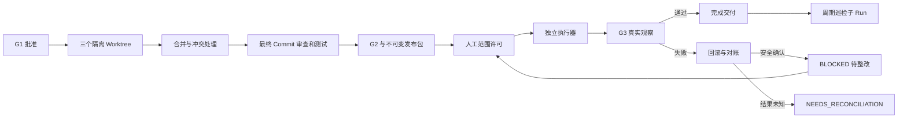

# Phase 3：多角色研发、受控发布与运维

版本：0.4.0。实现范围对应需求说明书第三阶段，以及 AC-49/50/52/54/56/57/58/59 的本地验收。

最终全量验证：**457 passed，0 failed，0 skipped**，包含 **74 项第三阶段用例和 3 项真实 Java 集成**。最后的上下文补充后另有 **34 项相关回归通过**；这些用例与全量存在重叠，不重复相加。安装包独立安装、51 个模块的源码一致性、13 角色模板、依赖和差异格式检查均通过。汇总及源码摘要见 `phase3-completion.json`，包验证见 `phase3-packaging-validation.json`。

## 已实现的流程

Frontend、Backend、DevOps 分别在真实 Git Worktree 中修改受架构批准的文件。三方候选提交按受控顺序集成；冲突生成独立工单并保留当前集成结果；显式解决后重新检查最终 Commit。Git 引用更新与业务库之间发生中断时，恢复依据已持久化的 PREPARED 记录；发现其他编辑时拒绝覆盖，包括仅改变空白的编辑。

最终集成 Commit 依次经过 Code Review、固定 Java HTTP 测试、前端文档检查、部署配置 Schema 校验、研发出口验收和独立安全策略扫描。当前策略覆盖 Java 进程执行和前端动态代码模式，不代表完整漏洞扫描。确定性代码策略问题可自动分派整改；未知根因仍等待人工分类。DevOps 只能提交受 Schema 约束的交付配置，不能把候选命令变为生产执行权限。

G2 通过后，由受信打包器生成带源 Commit 的不可变发布包。Release、发布申请、人工许可、部署尝试、外部操作 ID、G3 观察证据均绑定同一产物和目标。真实部署的 G3 必须读取执行器凭据与独立观察产物，模型或调用方自报的健康布尔值不能单独放行。



## 执行与授权约束

- `side_effect_executor` 角色仅允许绑定独立 `system_service` 主体。发起 Agent、执行器和发布批准人分别校验；Agent 不能代替人类签发许可。
- 部署能力取平台、部门、Agent、任务交集并扣除 deny。Backend/Frontend/DevOps 无论如何申请，均不能获得部署能力；Operations Expert 仍必须持有效人工许可。
- 执行前检查 G1/G2 新鲜性、Release 基线、发布包摘要与源 Commit、环境、精确单目标、目标配置摘要、操作范围、时间和剩余次数。本版执行器按单目标串行操作；多目标应分别签发许可。
- 目标登记只能由项目负责人执行。存在部署/恢复租约时，不能替换该目标配置；配置变更后旧许可不适用。
- 生产执行默认关闭。受信宿主需显式启用，CLI 还拒绝使用 `demo://` 演示身份批准生产。HTTP 生产代理需要 HTTPS，独立代理非回环监听须配置 TLS；凭据使用环境引用。
- 每个 Run 固定研发/执行模式，恢复时校验；真实发布 Run 不能通过其他阶段命令切换为模拟部署并标记交付。
- 外部写入前持久化操作 ID、参数摘要和租约。未知结果只查询对账，不能因超时重发。已结算的晚到部署响应不能覆盖已经确认的回滚结果。

## 失败、取消与巡检

G3 失败后先保留 REJECTED，进入 DEPLOYMENT_RECOVERY。回滚成功且实际健康检查确认旧版本安全时进入 BLOCKED，保存恢复证据和整改工单；回滚、健康或外部操作状态未知时进入 NEEDS_RECONCILIATION。人类项目负责人只能在安全证据仍有效时分类返工或终止：配置问题重新申请发布许可；代码、产品、架构问题分别定向回相应阶段，并使受影响 Gate 失效。

原许可过期而回滚尚未发送时，可申请仅含 ROLLBACK 的新许可，再执行恢复。已经发送而未知的回滚必须先查询原操作，不能借新许可盲重放。新部署重试创建新的 Deployment/G3，原 REJECTED 不覆盖。

取消意图持久化后拒绝新 Worker、模型调用、合并和外部部署。准备后但尚未发送的请求直接结算为取消；已经发送的请求按操作 ID 查询，必要时发送一次取消信号，并在有效权限下补偿回滚。仍有未知操作或安全状态未确认时保持 NEEDS_RECONCILIATION。恢复阶段只有具备取消意图、全部副作用结算和安全证据，才能进入 CANCELLED。

为使这条取消路径与状态表一致，需求说明书 §2.2 的恢复组合守卫补充了带上述限制的 CANCELLED。未放宽“未知副作用不能终止”的条件。

巡检计划、到期时间和待观察子 Run 均持久化；重启可以继续检查。巡检产生 MAINTENANCE 子 Run；不可达或异常时产生独立 INCIDENT 子 Run 并等待处理。父交付 Run 保持原 COMPLETED 状态。巡检读取常驻代理，不为检查而重新启动目标。

风险豁免提供申请、人工批准/拒绝、撤销和时效/版本校验。严重度取自真实 Issue，P1/严重漏洞不能变为 ACTIVE。撤销会使相关质量门禁失效。

## 可运行的本地命令

先运行真实 Java 验证的多角色交付示例，角色输出默认使用可复现脚本：

```powershell
$python = 'E:/VibeCoding/Langgraph-proj/.venv/Scripts/python.exe'
$java21 = 'E:/VibeCoding/Langgraph-proj/.agentloop/toolchains/jdk-21.0.12.1+1'
$maven = 'E:/CodeEnv/Java/Maven/binary/apache-maven-3.9.16/bin/mvn.cmd'

& $python -m agentloop phase3-run --java-home $java21 --maven $maven
& $python -m agentloop phase3-status
# 流程停在 RELEASE_AUTHORIZATION / WAITING_APPROVAL。
```

常驻部署通过独立代理提供。下面创建不含明文秘密的目标配置，并向子进程环境注入随机本地测试凭据；凭据不会输出到控制台。

```powershell
$state = & $python -m agentloop phase3-status | ConvertFrom-Json
$target = @{
  target_id = 'local-staging'
  project_id = $state.run.project_id
  environment = 'staging'
  provider = 'http-agent'
  endpoint = 'http://127.0.0.1:8766'
  secret_ref = 'env:AGENTLOOP_DEPLOY_AGENT_TOKEN'
}
[IO.File]::WriteAllText(
  (Join-Path (Get-Location) '.agentloop/phase3-target.json'),
  ($target | ConvertTo-Json), [Text.UTF8Encoding]::new($false))
$env:AGENTLOOP_DEPLOY_AGENT_TOKEN = [Guid]::NewGuid().ToString('N') + [Guid]::NewGuid().ToString('N')
$agent = Start-Process -FilePath $python -WindowStyle Hidden -PassThru `
  -ArgumentList @('-u', '-m', 'agentloop', 'phase3-agent', '--target-file', '.agentloop/phase3-target.json') `
  -RedirectStandardOutput '.agentloop/phase3-agent.log' `
  -RedirectStandardError '.agentloop/phase3-agent-error.log'

& $python -m agentloop phase3-target --target-file .agentloop/phase3-target.json
$request = & $python -m agentloop phase3-request | ConvertFrom-Json
# 本地演示使用 demo-owner 人类身份；真实身份应由受信认证网关提供。
$auth = & $python -m agentloop phase3-approve --request-id $request.authorization_request_id | ConvertFrom-Json
& $python -m agentloop phase3-deploy --authorization-id $auth.authorization_id
& $python -m agentloop phase3-status
```

同一部署请求重复执行只复用已结算结果。再次尝试使用新的幂等键，例如 `--idempotency-key deployment-2`，并先获得新的有效许可。

代理日志中的 `application_url` 是该主机回环地址上的实际静态服务。代理保持运行，发布命令退出后服务仍可访问。内置后端发布静态资源，不执行包内脚本；Spring 后端在本阶段实际运行于 Maven/JUnit HTTP 测试中，未声称它已作为生产服务发布。对外入口、Java/OCI 服务发布器和基础设施配置需按目标环境接入 Provider。

巡检与取消：

```powershell
& $python -m agentloop phase3-schedule --interval 300
& $python -m agentloop phase3-tick
& $python -m agentloop phase3-watch
# watch 按 Ctrl+C 退出。需要停止测试代理时，仅停止本次启动的进程：
# Stop-Process -Id $agent.Id

& $python -m agentloop phase3-cancel
& $python -m agentloop phase3-settle-cancel
# NEEDS_RECONCILIATION 下，根据 phase3-status 中的 effect_id 查询：
& $python -m agentloop phase3-reconcile --effect-id '<effect-id>'
```

故障整改：

```powershell
& $python -m agentloop phase3-remediate --deployment-id '<deployment-id>' --cause ENV_DEFECT
# 然后 phase3-request → phase3-approve → phase3-deploy（新幂等键）。
# CODE_DEFECT / SPEC_DEFECT / ARCH_DEFECT 分类后运行：
& $python -m agentloop phase3-rework --java-home $java21 --maven $maven
# 安全恢复后放弃交付：
& $python -m agentloop phase3-terminate --deployment-id '<deployment-id>'
# 许可过期且回滚尚未发送：
& $python -m agentloop phase3-request --rollback-only
& $python -m agentloop phase3-rollback --deployment-id '<deployment-id>' --authorization-id '<new-rollback-authorization-id>'
```

风险豁免：

```powershell
& $python -m agentloop phase3-waiver-request --issue-id '<issue-id>' --rationale '<理由>' --controls '<补偿控制>'
& $python -m agentloop phase3-waiver-approve --waiver-id '<waiver-id>' --principal-id demo-security
& $python -m agentloop phase3-waiver-revoke --waiver-id '<waiver-id>' --principal-id demo-security
```

真实模型可通过 `phase3-config --output .agentloop/phase3-models.json` 生成 13 角色模板，并在运行、确认、返工时提供 `--runtime-config`。这一路径沿用 Phase 2 的预检、预算和不可变快照；有效凭据及提供方可用性是前置条件。脚本验收不代表真实模型修复质量。

本次 DeepSeek 模型列表预检仍返回 HTTP 401，记录见 `phase3-provider-preflight.json`；没有成功在线生成的证据。

## 出口条件与证据

| 出口/验收 | 对应用例 |
| --- | --- |
| 无权限/无许可拒绝；目标、产物、时间、角色失效拒绝 | AC-12/54/56/57，`test_phase3_operations.py`、`test_phase3_governance.py` |
| G3 失败、安全回滚、未知状态、重新授权与新 G3 | AC-49/50/58，`test_phase3_operations.py` |
| 低风险豁免完整生命周期，硬阻断不得批准 | AC-52，`test_phase3_governance.py` |
| 产品/架构/代码返工和 Gate 失效；安全终止 | AC-59，`test_phase3_operations.py`、`test_phase3_parallel.py` |
| 取消前后竞态、未知状态、晚到响应 | AC-24/42，`test_phase3_operations.py` |
| 隔离修改、真实冲突、解决、Git/SQLite 中断恢复 | AC-43，`test_phase3_parallel.py` |
| 真实 Maven/Spring、最终 Commit、实际 HTTP 发布与巡检 | `test_phase3_integration.py` |
| 跨命令发布幂等、常驻服务、代理断开与父子隔离 | `test_phase3_cli.py` |

最终结果见 `phase3-validation.json`；REQ/AC 关联表示相应用例的证据，不表示全部 49 项需求已交付。生产环境、企业 IdP、完整漏洞扫描、OS 沙箱和真实模型质量需分别验收。当前 `frontend/` 工作台仍是既有本地演示入口；第三阶段通过服务和 CLI 提供能力。

协议和实现依据：[Git Worktree](https://git-scm.com/docs/git-worktree)、[三方合并计算](https://git-scm.com/docs/git-merge-tree)、[引用 CAS](https://git-scm.com/docs/git-update-ref)、[LangGraph 持久化](https://docs.langchain.com/oss/python/langgraph/persistence)。
