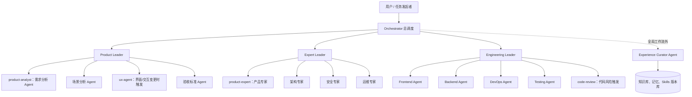
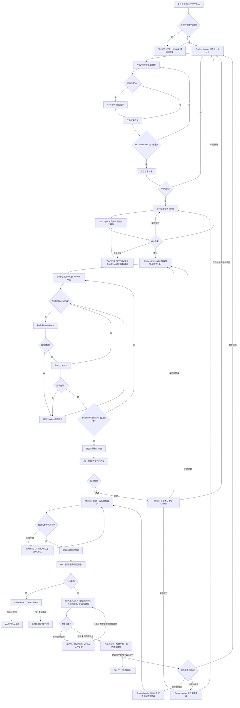
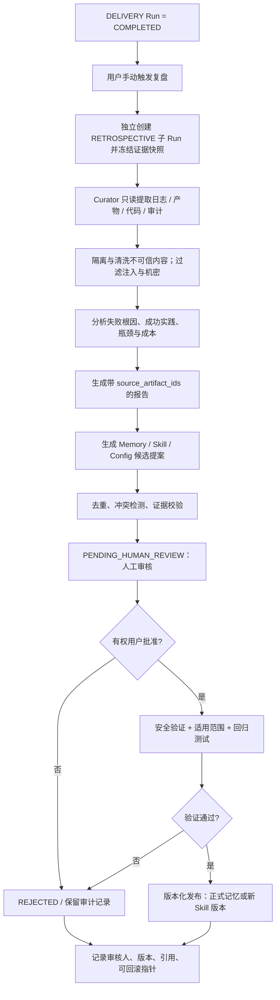

# 多 Agent 研发 Loop 平台：架构与实施规格说明书

> 版本：v1.2（迁移闭环、权限与 API 契约修订）  
> 日期：2026-10-18  
> 状态：待实现 / 可执行设计基线（待用户正式确认）  
> 目标读者：架构开发者、Codex/编码 Agent、测试人员  
> 技术基线：Python + LangGraph；桌面端建议 Tauri + React；具体版本在开发时锁定并验证。  
> 说明：本文件是**目标系统的设计规范**，不代表相关功能已经实现；文内的 API、数据结构及目录均为拟定协议，实际开发须验证兼容性。

---

> **v1.1 修订范围（2026-10-18）**：补充向用户澄清与中断恢复、可配置的需求/架构人工确认、发布授权和 RBAC、阶段/状态正交状态机、确定性责任路由、UX 与 Code Review 的触发点、运维子 Run、长期记忆人工审核、术语规范、需求—验收追踪，以及预算/Schema/注入/回退/豁免/取消/并发冲突测试。已确定的三部门架构、Leader 出口验收、研发内部自动 Loop 保持不变。

> **v1.2 修订范围（2026-10-18）**：补齐 G3 失败后回滚/对账与下一跳；发布正式的 Phase、Status、GateResult 迁移白名单和拒绝规则；统一 RBAC 角色、Capability 与发布操作的命名空间；修正附录 A 的运维授权冲突；补充 Release、ReleaseAuthorizationRequest 与部署尝试数据模型；明确审批请求由 GateEvaluator 创建、非 Agent 手动提交；补齐风险豁免与记忆提案的审批 API；完善 AC-49～AC-59。保留 v1.1 需求编号，不改变三部门和 Leader 负责制。

## 0. 产品定位与设计原则

### 0.1 产品定义

构建一个**可配置、可恢复、可审计、可持续积累经验**的多 Agent 软件研发工具。系统模拟软件组织的明确职责，但不模拟无效的层层审批：部门 Leader 负责拆分和分发初始任务、接收外部整改、验收本部门最终成果；专业 Worker 在授权范围内独立协作与循环修复。

支持输入：Bug 报告、功能需求、技术改造请求。  
支持输出：产品规格、架构设计、代码变更、测试证据、安全评估、部署记录、维护任务，以及用户主动触发的交付复盘和长期经验更新。

### 0.2 已确定且不可随意改动的业务规则

1. 组织结构只有三个正式部门：**产品部门、研发部门、专家部门**。不单设测试部门。
2. 研发部门的测试能力集中到**一个 Testing Agent**；它可以按需使用多个测试工具，但不因此扩张为测试部门。
3. 部门内部 Worker 的正常交接和局部返工**不需要 Leader 逐次审批**。
4. Leader 主要承担：**入口任务理解和细化、初始分派、最终部门验收、跨部门协同、外部整改接收、异常升级**。
5. 产品部门产出的材料先由 Product Leader 最终验收，再送专家部门进行**前置产品审计与架构设计**；前置通过后，研发才可开始实施。
6. 研发必须同时获得**批准版本的产品文档和架构设计**，不得自行把未批准的架构假设当成需求。
7. 研发 Agent 与 Testing Agent 自动执行“开发→测试→修复→重测”局部 Loop；最终由 Engineering Leader 验收部门成果。
8. 研发验收后进入**安全专家评估**；存在未解决 P1 级阻断性缺陷或严重安全漏洞时，禁止进入正式发布。
9. 只有发布门禁通过，**运维专家**才负责按授权将产品部署到指定服务器，并独立承担后续周期巡检和维护。
10. 专家拒绝时，**直接向责任部门 Leader 发送结构化整改工单**；不得绕过 Leader 指挥该部门 Worker。
11. **用户主动触发交付复盘**。系统不得在每次提交、每轮测试或任务结束时擅自启动完整复盘。
12. 设立专职 **Experience Curator Agent（经验管理员）**，负责归档、复盘、维护各子 Agent 的个人经验、共享长期记忆和 Skills 改进提案。
13. 模型、Skills 和 MCP 权限可按**平台、部门、Agent、任务**分层配置，并能够通过本地配置或受信来源手动下载/安装。
14. **信息不足或需要业务决策时进入 `PAUSED_FOR_HUMAN`**；必要时对用户询问，不允许编造关键需求或制造隐式默认值。
15. Spec 与架构的**用户确认是可配置的额外门禁**，不替代 Product Leader 和前置专家审计。
16. **发布授权**必须由经过 RBAC 授权的真人签发，绑定环境、产物、范围和有效期；模型/Agent 不能自行批准。
17. **Run 的 `phase` 和 `status` 正交**，每个质量门禁另有独立的 GateResult 状态。
18. **LoopRouter 是确定性代码**；事件不得接受模型自行指定的目标 Leader。
19. **首版所有长期记忆统一进入人工待审队列**，Experience Curator 不能直接把候选写进正式记忆或 Skills。

### 0.3 非目标（首版）

- 不追求 Agent 数量最大化；按任务选择必要成员。
- 不允许模型自行决定越过安全门禁、篡改质量结论或未经授权部署到生产服务器。
- 不在首版实现自治训练基础模型或微调模型。
- 不将全部历史对话直接塞进模型上下文；仅检索与当前任务相关的证据。
- 不将任何复盘结论未经验证直接写入生产 Skills、模型系统提示词或执行权限。

### 0.4 术语

- **Loop**：失败后根据责任和影响范围定向修复、验证的闭环；不是简单的无限 `while`。
- **Quality Gate（质量门禁）**：由确定性规则判断能否进入下一阶段的检查点。
- **Artifact（中间产物）**：规格说明、设计、代码差异、测试报告、审计意见等可追溯文件。
- **Skill**：可复用的工作方法、操作步骤与配套资源，核心文件为 `SKILL.md`。
- **MCP**：模型上下文协议，用于规范化接入工具、资源和外部服务；MCP Tool 可产生实际副作用。
- **Memory**：对过去经验、上下文或事实的持久记录；不等同于 Skill，也不能天然拥有执行权限。
- **Run**：一次可独立追踪的执行单元，包括交付任务、运维任务、事件处理或人工复盘。
- **Phase**：Run 当前所在流程阶段（例如 `ENGINEERING`、`G2`），不是运行状态。
- **Status**：Run 的运行状态（例如 `RUNNING`、`PAUSED_FOR_HUMAN`、`COMPLETED`），与 Phase 正交。
- **RBAC**：按认证主体拥有的角色决定哪些操作可被请求；角色标识与工具能力标识严格分离，所有决策以服务端校验为准。
- **角色（Role）**：主体身份的职责标签，如 `release_approver`、`operator`，用于判断是否可以发起/批准某类操作；不是 MCP Tool 授权本身。
- **能力（Capability）**：统一的可执行能力标识，规范使用 `cap.*`，如 `cap.repo.read`、`cap.deploy.production`。
- **发布操作（Release Action）**：发布令牌所允许的 `DEPLOY`、`ROLLBACK` 等操作，是授权范围，不是用户角色也不是 `cap.*`。
- **GateResult**：门禁在特定产物版本、规则版本下的检查记录，不能只靠模型说“PASS”。
- **规范术语**：`product-analyst` = 需求分析 Agent（产品 Worker）；`product-expert` = 产品专家（专家 Worker），两者是不同角色；其他角色 ID 采用小写英文连字符，不混用姓名/部门/临时标题。

### 0.5 编号需求基线与验收追踪规则

- 所有带规范效力的关键需求使用永久编号 `REQ-001` 起；修改要求保留原编号、更新版本，不允许无记录改写语义。质量属性同样以 `REQ` 编号管理。
- 第 12 节每条验收用例包含关联 `REQ`、输入/动作、数据库/工具调用断言；CI 生成需求到验收的追踪报告。不得只验证 Agent 回复文本。
- 后续新增需求使用新编号，不回收已删除编号；本节是 v1.2 的权威需求索引，正文为约束细化。

| 需求编号 | 规范性要求 |
|---|---|
| REQ-001 | 组织仅设产品、研发、专家三个正式部门；测试为研发内单一 Agent |
| REQ-002 | Leader 负责入口分配、出口验收、外部整改与异常升级；内部流转不逐轮审批 |
| REQ-003 | 产品产物先经 Product Leader 验收，再经产品专家审计和架构专家设计审核 |
| REQ-004 | UX Agent 按用户界面/交互变更条件触发，输出进入产品验收与前置审计 |
| REQ-005 | G1 必须验证 Spec、产品专家审计和架构设计的同版本有效性 |
| REQ-006 | 对不完整、冲突或关键未知需求向用户澄清并持久化暂停/恢复 |
| REQ-007 | Spec 和架构可配置用户确认，默认策略必须明确且可追溯 |
| REQ-008 | 研发只能消费经 G1 通过的 Spec 与 Architecture 版本 |
| REQ-009 | 研发专业 Agent 与 Testing Agent 自动局部返工，不逐轮经过 Leader |
| REQ-010 | Code Review Agent 在明确触发条件下运行，并计入研发出口验收 |
| REQ-011 | 研发最终交付需要 Engineering Leader 验收及完整可追溯测试证据 |
| REQ-012 | G2 阻止存在未解决 P1 或严重安全漏洞的发布 |
| REQ-013 | 非阻断风险豁免必须有授权、期限与适用版本；硬性阻断不得豁免 |
| REQ-014 | 生产部署必须持有具备角色权限、范围、有效期和产物绑定的发布授权 |
| REQ-015 | 权限采用 RBAC 与最小授权，人工身份和 Agent 服务身份必须区分 |
| REQ-016 | 运维专家仅在授权后部署，G3 独立记录健康检查与回滚结果 |
| REQ-017 | 运维巡检和事件处理产生关联父 Run 的独立子 Run |
| REQ-018 | Run 的 Phase、Status 和 GateResult 状态彼此独立，G1/G2/G3 均可审计 |
| REQ-019 | LoopRouter 使用确定性、服务端的归属策略，Agent 不得指定 target_leader |
| REQ-020 | 整改工单需证据、责任类别、影响分析和版本依赖，并定向返工 |
| REQ-021 | Loop 必须有轮数、超时、无进展、成本和取消边界 |
| REQ-022 | 模型可按平台/部门/Agent/任务单独配置并锁定有效快照 |
| REQ-023 | 模型调用故障按合规回退链切换，不得借回退放宽权限或质量门槛 |
| REQ-024 | 成本与 Token 预算在调用前检查并在执行中持续记账 |
| REQ-025 | Agent 输出严格 Schema 校验，失败按限额修复/重试，不能自动判 PASS |
| REQ-026 | Skills 支持四级配置、来源校验、版本锁定、手动下载安装及回滚 |
| REQ-027 | MCP 支持分层白名单、工具级授权、独立凭据和调用审计 |
| REQ-028 | 外部内容/工具返回/日志/历史记忆均不可信，必须防提示词注入 |
| REQ-029 | 用户显式触发交付复盘，Experience Curator 仅产出候选知识与提案 |
| REQ-030 | 首版全部长期记忆必须人工审查批准后进入可检索正式命名空间 |
| REQ-031 | Skill/提示词/配置变更必须审查和验证，不得通过经验自动提权 |
| REQ-032 | Artifact 不可变且按版本/哈希引用，支持完整证据回溯 |
| REQ-033 | 恢复与副作用操作需幂等键、审计及对账机制 |
| REQ-034 | 取消 Run 时需处理中途副作用、补偿/回滚和未知状态对账 |
| REQ-035 | 并行开发使用隔离 Worktree，冲突单独跟踪并验证合并结果 |
| REQ-036 | API/UI 支持澄清、审批、撤销、权限审计和版本比对 |
| REQ-037 | 需求、测试与发布条件不得被 Agent 私自改写、降级或绕过 |
| REQ-038 | 完整交付 Run 可独立结束，维护与复盘不延长原 Run 生命周期 |
| REQ-039 | 失败、重试、工具调用、成本、审批与审计日志完整可观察 |
| REQ-040 | 多用户项目隔离、凭据安全存储、最小可见记忆范围 |
| REQ-041 | G3 失败必须进入部署恢复子流程；回滚成功、未知或失败分别有确定状态及出口 |
| REQ-042 | Phase/Status/GateResult 分别使用完整可机测白名单；非法组合/跃迁原子拒绝 |
| REQ-043 | 规范 RBAC 角色、工具 Capability 与发布 Action 三套不同概念，并统一各层配置的 Capability 名称 |
| REQ-044 | Release 必须作为正式实体存在，发布申请、授权、部署均绑定同一版本和范围 |
| REQ-045 | 风险豁免需申请、人工决策、撤销、失效与审计 API；硬阻断不允许批准 |
| REQ-046 | MemoryProposal 必须独立人工审核 API；与 Skills/配置的 EvolutionProposal 区分 |
| REQ-047 | G1 审批请求只能由 GateEvaluator 经服务端幂等创建；用户仅能要求启用 optional 确认或提交决策 |
| REQ-048 | 运维专家在获得平台/专家部门/自身 Capability 与有效人工发布授权后方可部署，附录配置不得全局禁用运维职责 |
| REQ-049 | 所有 G1/G2/G3 驳回分支必须返回合法阶段，必要时按证据路由责任 Leader 且使受影响门禁失效 |

---

## 1. 组织模型与角色权限

### 1.1 组织架构



**说明**：Experience Curator 属于平台治理角色，不隶属于任何研发业务部门，也不参与日常研发审批。它只在明确授权的复盘与维护流程中修改知识资产。

### 1.2 各角色的输入与交付

| 角色 | 输入 | 核心责任 | 输出 | 主要权限 |
|---|---|---|---|---|
| Orchestrator | 用户任务与全局配置 | 生命周期、依赖、阶段路由、门禁和异常升级 | Run 状态、任务事件 | 不直接改业务代码 |
| Product Leader | 原始需求与已有资产 | 需求细化、分配、最终验收 | 批准候选 Spec | 产品文档编辑/验收 |
| 产品 Worker（含 `product-analyst`、`ux-agent`） | 指定子任务 | 场景、规则、UX、验收条件 | 结构化子产物 | 限定产品工作区 |
| Expert Leader | 待审计材料 | 分配专家、汇总结论、专家部门成果验收 | 审计结论、整改工单 | 不能代替安全门禁程序 |
| `product-expert` 产品专家 | Product Spec | 需求一致性、完整性、业务风险审计 | 产品审计报告 | 只读材料、报告写入 |
| 架构专家 | 已审计的 Spec | 设计模块、接口、数据流、风险与部署边界 | Architecture Design | 设计区写入，不改生产代码 |
| Engineering Leader | 已批准 Spec + Architecture | 初始研发分派、跨专业协调、最终验收 | 研发交付包 | 研发集成/验收 |
| Frontend/Backend Agent | 派发子任务 | 实施具体代码和自测 | Git Diff、执行证据 | 受限代码工作区 |
| DevOps Agent | 技术方案 | 交付脚本、镜像构建、部署配置（非实际生产部署） | 可部署包、配置模板 | 非生产运行权限 |
| Testing Agent | Spec + 代码与产物 | 设计及执行测试、判定失败、定位责任建议 | 测试报告、缺陷 | 隔离测试环境运行 |
| Code Review Agent | 代码 Diff | 可维护性、约束一致性、代码风险扫描 | Review 报告 | 只读或建议修改 |
| 安全专家 | 研发交付包 | 依赖、鉴权、机密数据及漏洞评估 | 安全报告、阻断判定 | 只读代码与安全扫描工具 |
| 运维专家 | 已获发布许可的产物 | 发布、验证、回滚、巡检、维护 | 部署记录、维护工单 | 按环境授权的部署工具 |
| Experience Curator | 用户触发 + 完整交付档案 | 复盘、提炼经验、记忆维护、Skill 改进候选 | 复盘报告、记忆条目、更新提案 | 不允许直接扩大任一 Agent 权限 |

### 1.3 Leader 边界（强约束）

**需要 Leader 参与**：部门入口的任务拆分与首轮分发；部门最终交付物验收；跨部门问题接收；不确定性、权限或成本异常升级。  
**不需要 Leader 参与**：需求 Worker 的中间交接；代码完成后进入测试；测试失败退回对应开发者；修复后自动重测；测试脚本内部返工。

> 特例：任务超出权限、超过返工上限、影响上游已批准基线、需变更生产资源、责任归属不明时，应暂停或升级，不允许借“内部自动流转”规避安全控制。

---

## 2. 总工作流、质量门禁与 Loop（REQ-003～021）

### 2.1 主流程：动态触发 UX 与 Code Review

主流程的判断节点只读取服务端 Gate/授权状态，不采信 Agent 自报的 PASS。图内的缺陷返工与部署恢复均是可持久化的子流程，而不是跳过门禁的捷径。



**主流程与文字对齐的四项约束**：

1. `Product Leader` 出口验收发生在 `product-expert` 审计之前；`architecture-expert` 的设计是 G1 必需输入。`UX Agent` 仅在变更 UI/交互时触发；`Code Review Agent` 仅在策略触发时执行。两者的结果都要绑定输入版本。
2. G1 不通过返回产品 Leader 或架构专家；G2 不通过根据 `root_cause` 路由到相应部门 Leader，再从受影响的上游阶段进入，绝不复用已经失效的 G1/G2 结论。
3. `Release` 在 G2 通过后创建。部署**授权申请**可以由流程自动发起，但**批准必须由授权真人**完成；拒绝/过期不能自动进入部署。详情见 2.8、7.1、8.4。
4. G3 失败必经 `DEPLOYMENT_RECOVERY`：未知/回滚失败停在 `NEEDS_RECONCILIATION`；确认安全回滚后停在 `BLOCKED`，经整改和重新授权才允许部署重试；放弃可在证据完备后终止为 `FAILED`。不得从失败的 G3 直接进入 `DELIVERY`。故障事件还可以关联 `INCIDENT` 子 Run，但子 Run 不代替父 Run 的恢复状态。

### 2.2 状态机正交设计（REQ-018、041、042、049）

三个枚举维度分别持久化；任何检查与状态切换必须经服务端 `StateTransitionService`/`GateEvaluator`，在单事务内检查 `state_version`（乐观锁）并追加 `ExecutionEvent`，失败不能部分落库。

- `Run.phase`（所处业务阶段）：`INTAKE`、`PRODUCT`、`PRODUCT_AUDIT`、`ARCHITECTURE`、`G1`、`ENGINEERING`、`SECURITY_REVIEW`、`G2`、`RELEASE_AUTHORIZATION`、`DEPLOYMENT`、`G3`、`DEPLOYMENT_RECOVERY`、`DELIVERY`。运维/事件/复盘子 Run 分别使用 `MAINTENANCE`、`INCIDENT_RESPONSE`、`RETROSPECTIVE`。
- `Run.status`（执行状态）：`CREATED`、`RUNNING`、`WAITING_GATE`、`PAUSED_FOR_HUMAN`、`WAITING_APPROVAL`、`BLOCKED`、`CANCEL_REQUESTED`、`CANCELLING`、`NEEDS_RECONCILIATION`、`FAILED`、`CANCELLED`、`COMPLETED`。
- `GateResult.status`（某次门禁判定）：`NOT_EVALUATED`、`PENDING`、`PASSED`、`REJECTED`、`STALE`。每次部署/版本重新评估均创建**新 GateResult**；过往 REJECTED 和相关证据不可抹除。`WAITING_APPROVAL` 只属于 Run。

#### 2.2.1 DELIVERY Run 阶段迁移白名单（包含所有正向、返工和恢复出口）

| 当前 `phase` | 允许的下一 `phase` | 守卫条件和说明 |
|---|---|---|
| `INTAKE` | `PRODUCT` | 任务信息充分，或已答复关键澄清 |
| `PRODUCT` | `PRODUCT_AUDIT` | Product Leader 验收完成 |
| `PRODUCT_AUDIT` | `PRODUCT`, `ARCHITECTURE` | 产品专家拒绝→产品；通过→架构 |
| `ARCHITECTURE` | `PRODUCT`, `G1` | 依赖的 Spec 改变→产品；架构审查通过→G1；纯架构返工留在本阶段 |
| `G1` | `PRODUCT`, `ARCHITECTURE`, `ENGINEERING` | 按拒绝原因退回；只有最新 G1 `PASSED` 可进研发；人工审批未决时同阶段等待 |
| `ENGINEERING` | `PRODUCT`, `ARCHITECTURE`, `SECURITY_REVIEW` | 发现上游需求/架构缺陷→相应上游；研发出口验收→安全审查；内部测试返工同阶段 |
| `SECURITY_REVIEW` | `G2`, `ENGINEERING`, `PRODUCT`, `ARCHITECTURE` | 安全证据就绪→G2；若提前发现高风险，允许经 Router 定向退回（G2 未放行） |
| `G2` | `ENGINEERING`, `PRODUCT`, `ARCHITECTURE`, `RELEASE_AUTHORIZATION` | 拒绝按根因路由；仅当有效 G2 `PASSED` →发布准备 |
| `RELEASE_AUTHORIZATION` | `DEPLOYMENT`, `ENGINEERING`, `PRODUCT`, `ARCHITECTURE` | 有效人工授权→部署；基线失效退回相应上游；待审批/拒绝仍停本阶段等待或阻断 |
| `DEPLOYMENT` | `G3`, `DEPLOYMENT_RECOVERY` | 部署成功并有操作证据→G3；部署失败/取消在途副作用→恢复 |
| `G3` | `DELIVERY`, `DEPLOYMENT_RECOVERY` | 新鲜 G3 `PASSED` 才能交付；任意失败/超时/未知→恢复 |
| `DEPLOYMENT_RECOVERY` | `RELEASE_AUTHORIZATION`, `ENGINEERING`, `PRODUCT`, `ARCHITECTURE` | 只在远端状态已核实且无未决副作用后转出；纯部署修复需重申请有效授权；代码/需求/架构根因退对应上游 |
| `DELIVERY` | 无 | 唯一成功终点，且 `status=COMPLETED`、G3 最新 `PASSED` |

**留在当前阶段**允许内部 Worker Loop、等待、重试 Gate 或整改；这不是绕开下一阶段守卫的自环。上游返回不必经过中间无关阶段，但只有受影响的 Gate 全部重新评估通过后才能再次下游。若前置基线改变，新 Spec/架构审计必须重新经 `PRODUCT_AUDIT → ARCHITECTURE → G1`；表中直接退 `ARCHITECTURE` 仅适用于 Spec 未改变的纯架构问题。直接退 `PRODUCT` 时照常进入产品专家审计。

#### 2.2.2 Run.status 迁移白名单（与 phase 正交）

| 当前 `status` | 可转到 | 约束 |
|---|---|---|
| `CREATED` | `RUNNING`, `CANCEL_REQUESTED`, `FAILED` | 启动持久化成功后运行 |
| `RUNNING` | `WAITING_GATE`, `WAITING_APPROVAL`, `PAUSED_FOR_HUMAN`, `BLOCKED`, `CANCEL_REQUESTED`, `NEEDS_RECONCILIATION`, `FAILED`, `COMPLETED` | `COMPLETED` 仅允许原子进入 `DELIVERY` 且 G3 `PASSED` 的 DELIVERY Run，或各子 Run 完成其专属终止条件 |
| `WAITING_GATE` | `RUNNING`, `WAITING_APPROVAL`, `PAUSED_FOR_HUMAN`, `BLOCKED`, `CANCEL_REQUESTED`, `FAILED` | GateEvaluator 写出有效结果后才继续；不得直接 COMPLETED |
| `WAITING_APPROVAL` | `RUNNING`, `PAUSED_FOR_HUMAN`, `BLOCKED`, `CANCEL_REQUESTED`, `FAILED` | 批准→检查最新版本并恢复；拒绝/过期→留待处理或 BLOCKED |
| `PAUSED_FOR_HUMAN` | `RUNNING`, `WAITING_GATE`, `WAITING_APPROVAL`, `BLOCKED`, `CANCEL_REQUESTED`, `FAILED` | 仅合法人工答复、审查或取消可恢复，不能绕过 Gate |
| `BLOCKED` | `RUNNING`, `WAITING_APPROVAL`, `PAUSED_FOR_HUMAN`, `CANCEL_REQUESTED`, `FAILED` | 解除问题/新授权后恢复；`FAILED` 需有放弃或终止决定及副作用安全证明 |
| `CANCEL_REQUESTED` | `CANCELLING`, `NEEDS_RECONCILIATION` | 禁止新副作用，仅清算已发起调用 |
| `CANCELLING` | `CANCELLED`, `NEEDS_RECONCILIATION` | 仅无未决副作用才能取消完毕 |
| `NEEDS_RECONCILIATION` | `CANCELLING`, `BLOCKED`, `RUNNING`, `FAILED` | 只有核对完毕且记录处置证据、对应的人类/策略授权后才能退出；不能直接 COMPLETED |
| `FAILED`, `CANCELLED`, `COMPLETED` | 无 | 终态不可复活；新工作新建 Run |

非法的 `phase` 边、`status` 边、终态复活、跨项目/角色、过期审核、无效 `input_digest`、缺少 Gate 证据和违反组合约束一律返回 `409 INVALID_TRANSITION` 或 `403 FORBIDDEN`，不修改原状态。`phase` 和 `status` 必须按复合守卫共同检查，而不是各自通过即放行。

**组合守卫（最低集合）**：`phase=G1|G2|G3` 且评估待决时 `status=WAITING_GATE|WAITING_APPROVAL|RUNNING`；`phase=DEPLOYMENT_RECOVERY` 可以是 `RUNNING|BLOCKED|NEEDS_RECONCILIATION|CANCEL_REQUESTED|CANCELLING|FAILED`；`phase=DELIVERY` 在父 Run 仅可为 `COMPLETED`；`COMPLETED` 的 `DELIVERY` 必须有最新 G1/G2/G3 通过且生效的批准和交付证据。澄清和全局故障 `PAUSED_FOR_HUMAN`、`BLOCKED` 可以出现在任一非终业务阶段，但 `NEEDS_RECONCILIATION` 必须关联真实未决 `ToolExecution` 或 `Deployment`。

#### 2.2.3 GateResult.status 独立迁移白名单

| 当前 GateResult.status | 允许到 | 说明 |
|---|---|---|
| `NOT_EVALUATED` | `PENDING` | 门禁创建后启动评估 |
| `PENDING` | `PASSED`, `REJECTED`, `STALE` | 仅 GateEvaluator 可写；等待人工确认保持 PENDING |
| `PASSED` | `STALE` | 上游产物/审批/策略改变，旧通过记录保留但失效 |
| `REJECTED` | 无 | 固定失败证据；整改后生成下一次判定记录 |
| `STALE` | 无 | 不可恢复；依据新输入再建新记录 |

同一 `gate_id`、同一输入摘要、同一策略版本的评估使用幂等约束，不重复创建有效 `PENDING`；不同部署尝试即便产物哈希相同，也应创建不同 G3 判定，并绑定 `deployment_id`。AC-32/46/51 必须同时覆盖三套状态与所有拒绝路径。

#### 2.2.4 G3 失败后恢复状态的确定性决策

| G3/部署结果 | 父 DELIVERY Run 的下一状态 | 必须执行 | 下一步合法出口 |
|---|---|---|---|
| 检查失败且回滚成功、目标恢复正常 | `(DEPLOYMENT_RECOVERY, BLOCKED)` | 记录失败 G3、回滚结果/环境快照，建故障工单 | 人类/策略允许整改后：仅配置→`RELEASE_AUTHORIZATION`；代码→`ENGINEERING`；产品→`PRODUCT`；纯架构→`ARCHITECTURE` |
| 回滚执行超时、结果未知、健康未确认 | `(DEPLOYMENT_RECOVERY, NEEDS_RECONCILIATION)` | 停止新部署，按外部操作 ID 查询，对账并升级 | 确认安全后→`BLOCKED`；取消中的→`CANCELLING`；不得直接再次部署 |
| 回滚明确失败且环境不安全 | `(DEPLOYMENT_RECOVERY, NEEDS_RECONCILIATION)` | 告警、隔离、人工处置并取证 | 环境修复且核对完成后→`BLOCKED`；明确终止并证明副作用已处理后可 `FAILED` |
| 确认安全回滚后用户放弃 | `(DEPLOYMENT_RECOVERY, FAILED)` | 有权用户的终止决定与安全状态证据 | 终态，无后续自动跳转 |
| 整改后再次部署 | `(RELEASE_AUTHORIZATION, WAITING_APPROVAL)` 或先回相应上游 | 重新检查新鲜 G1/G2、安全证据、**新的/仍有效且未耗尽的授权** | `DEPLOYMENT → G3`；新 G3 评估记录，旧 REJECTED 永久留档 |

恢复过程中，即使只是部署配置问题，也先由 Expert Leader 接收运维整改，由 Operations Expert 实施并留证，再进入重新授权。要使用部署尝试和副作用执行器记录，不能由 Agent 文本判断“已经回滚”；用户没有确认的高风险恢复动作须走相应授权。`FAILED` 不等价于已回滚；只有记录了可验证的最终环境状态和处置决定才可进入终态。

### 2.3 三道门禁与可配置的用户确认（REQ-005、007、012～016）

| Gate | 必要输入 | 程序化放行条件 | 失败处理 |
|---|---|---|---|
| `G1` 产品/架构 | Spec、产品专家报告、Architecture Design、两者版本哈希、可选用户签字 | Product Leader 已验收；产品专家 PASS；架构专家设计/审查 PASS；配置要求的人工确认已绑定当前版本 | 责任 Leader 重新提交；重新计算依赖 |
| `G2` 研发/安全 | Engineering Leader 验收、必测用例、Code Review 结果（若触发）、安全扫描与风险台账 | 无未解决 P1、无未解决严重安全漏洞；必须测试完成；非阻断豁免合规 | 原因归属到责任 Leader，整改后重测复审 |
| `G3` 部署 | 有效发布授权、部署尝试 ID、目标环境、镜像/产物哈希、冒烟与健康检查、回滚目标 | 部署前授权满足范围；部署后目标运行健康；关键检测通过；记录落库 | 强制进入 `DEPLOYMENT_RECOVERY`，按 2.2.4 决定 `BLOCKED` / `NEEDS_RECONCILIATION` / 最终 `FAILED`，不可直接交付 |

**人工 Spec/架构确认开关（建议默认值，可修改）**：

```yaml
human_approval:
  # 每个项目可覆盖，单 Run 可以在管理员允许范围内提高要求，不能降低强制策略
  spec: optional          # disabled | optional | required
  architecture: optional  # disabled | optional | required
  force_required_if: [new_external_api, irreversible_data_migration, high_business_impact]
  reviewer_role: [project_owner, product_approver]
  expires_after_hours: 72
```

- `disabled`：不需要用户确认，仍需 Leader 和专家；`optional`：用户可以选择要求本 Run 人工确认；`required`：必须等待授权用户决定。
- 开启时：**仅 GateEvaluator** 在首次评估 G1 时通过内部 `ApprovalRequestService.ensure_required()` 幂等创建 `ApprovalRequest(subject_type=SPEC|ARCHITECTURE, input_digest, approver_roles, expires_at)`；用户只能在 `optional` 策略下要求开启额外确认，或者对现有请求作决定。Agent、用户均不能直接伪造 G1 申请；界面展示版本 Diff、风险、批准/拒绝/补充意见；未收到有效批准之前禁止进入研发。
- 人工确认**只能批准指定内容版本**：Spec/架构的任何语义变更使旧批准失效；过期、撤销或审批身份不匹配均拒绝。一个项目可以要求两人确认，审批规则不得由 Worker 改写。
- 研发中的新需求影响已批准基线时，按影响范围重新运行产品/专家审查，并重新取得必要的用户确认。

### 2.4 用户澄清和 `PAUSED_FOR_HUMAN`（REQ-006、036）

以下条件**必须**触发澄清，不允许 Agent 自行猜测：

1. Bug 缺少复现路径/期望行为/环境，且代码、测试、日志等可用证据不足以安全确定修复目标；
2. 需求存在互相矛盾的约束，或关键业务规则有两种以上会产生明显不同结果的解释；
3. 涉及计费、资产、权限、数据删除、不可逆迁移、对外 API 契约等关键取舍，用户尚未授权选择；
4. 缺少服务器/发布范围等执行必需的目标信息，或者需要超出当前授权的高风险操作；
5. 用户对候选 Spec、架构或发布方案明确表示需要先确认；
6. 责任归属连续无法判定、预算申请超上限或人工放行条件尚未满足。

**不应随意暂停**：仅为风格偏好、能由已批准规范唯一确定的实现细节、内部可逆且风险受控的技术选择，不应反复询问用户。可以继续执行与未知条件无依赖的其他独立子任务。

```json
{
  "question_id": "q-001",
  "run_id": "run-001",
  "phase": "PRODUCT",
  "kind": "MISSING_REQUIREMENT",
  "question": "失败时希望接口返回 400 还是保持历史错误码？",
  "context_artifact_ids": ["spec-draft-2", "api-contract-1"],
  "options": ["保持历史行为", "改为 HTTP 400", "自定义"],
  "required_role": "project_owner",
  "blocking_task_ids": ["task-8"],
  "created_at": "2026-10-18T00:00:00Z",
  "status": "OPEN"
}
```

流程：分类器建议澄清 → 规则层判定是否必须暂停 → 落库 `ClarificationRequest`、持久化 checkpoint、设置 `PAUSED_FOR_HUMAN` → UI/API 通知有权用户 → 用户答复绑定 `question_id` 和当前基线 → 复核权限/版本/Schema → 恢复**原 checkpoint/thread_id**。拒绝答复、超时或用户选择取消时继续保持暂停或按显式策略终止；不得自动按第一个选项继续。

注意：LangGraph `interrupt()` 恢复时可能从节点开头重新执行，因此中断之前不能直接进行不可幂等的外部写操作；部署等操作必须经专门副作用执行器。见附录官方文档。

### 2.5 UX Agent 与 Code Review Agent 的确定性触发（REQ-004、010）

| Agent | 触发位置 | 启用条件 | 不触发时 | 审计要求 |
|---|---|---|---|---|
| `ux-agent` | 产品 Worker 形成场景和需求后，Product Leader 出口验收前 | 页面布局、用户交互、用户路径、可见错误提示、可访问性或 UI 状态发生变化 | 纯后台/数据修复无用户交互变更 | 存 `triggered`, `reason`, UX 产物版本；触发时必须进入 G1 输入 |
| `code-review` | 开发 Agent 提交候选 Commit 后，Testing 最终合格前 | 生产代码变更、公共 API/数据库迁移/认证授权变更、P1 修复、部署脚本敏感更改；建议首版只要修改生产代码即触发 | 仅文档或测试数据修改可跳过 | 存规则版本、Diff Hash、审查结论；触发后未通过不得部门验收 |

两者按规则自动触发，不由 Worker 自己决定跳过。Code Review 可以与不依赖其结论的初步测试并行，但 **Engineering Leader 出口验收必须等到两者应有结果全部有效**。Review 发现缺陷时发回责任开发 Worker 并重新验证修改后的 Commit。

### 2.6 四种 Loop、影响传播与终止（REQ-009、020、021）

1. **产品内部 Loop**：Worker 自动交接/核对；涉及需求取舍时暂停用户澄清；Product Leader 只验收出口。
2. **开发—代码审查—测试 Loop**：针对当前 Commit 的 Code Review、Testing 结果自动分类；同部门可直接返给责任 Worker；修复后重跑受影响检查，无逐轮 Leader 审批。
3. **专家整改 Loop**：专家提交 `issue.category + evidence`，由确定性 Router 找到责任 Leader；Leader 重新拆解、内部自动执行、出口验收，再复核变更影响的 Gate。
4. **运维事件 Loop**：巡检/告警触发独立的 `MAINTENANCE` 或 `INCIDENT` 子 Run；安全或跨部门问题通过 Router 转交责任 Leader；父交付 Run 保持完成状态。

每项缺陷默认最多 3 次无效返工（可配置）；持续同因失败、模型无有效进展、超时、预算不足、合并冲突未解决时，`BLOCKED` 或 `PAUSED_FOR_HUMAN` 并生成证据。修改 Spec/架构会使依赖它们的实现、测试、专家意见和审批按影响范围 `STALE`；不确定影响范围时采用保守策略扩大复核，不能省略安全门禁。

### 2.7 确定性责任路由（REQ-019、020）

**LoopRouter 必须是确定性代码，不允许 LLM 拥有最终路由权。** LLM 可以对故障分类、建议关联文件、提出责任归属推测；Router 按经过验证的 `category`、模块归属表、变更影响以及既定策略作最终决定。若证据不足、涉及多个部门或策略冲突，生成多责任工单或 `UNASSIGNED` 升级，不允许猜测 Leader。

| 规范 `category` | 默认责任部门 / Leader | 说明 |
|---|---|---|
| `SPEC_DEFECT` | product / `product-leader` | 业务与验收条件错误 |
| `UX_DEFECT` | product / `product-leader` | 交互定义错误 |
| `ARCH_DEFECT` | expert / `expert-leader` | 架构专家修订设计 |
| `CODE_DEFECT` | engineering / `engineering-leader` | 结合模块归属继续定位 Worker |
| `TEST_DEFECT` | engineering / `engineering-leader` | 可内部退回 Testing Agent |
| `SECURITY_FINDING` | 基于 `root_cause` 归属表判定 | 代码、需求、架构、配置可能不同；不能固定给研发 |
| `DEPLOY_FAILURE` / `ENV_DEFECT` | expert / `expert-leader`；若代码根因则 engineering | 运维专家处置后必要时派工 |
| `UNCLASSIFIED` | 不自动派工，升级 Orchestrator / 人工 | 保留分类不确定证据 |

关键规则：分类、归属表和 Gate 规则均存版本；输出含 `policy_version + routing_reason + evidence_ids`；不得读取 Agent 自报的 `target_leader` 作为目标。未经授权的目标、空证据、不可识别类别直接拒绝或等待补充。

### 2.8 发布授权、RBAC、例外与时效（REQ-013～015、043、044、045、048）

**唯一权限命名约定**（第 3.3、5.2、附录 A 必须使用完全相同的 `cap.*` 标识）：

| 维度 | 规范示例 | 用途 | 不允许混用的例子 |
|---|---|---|---|
| 人类/服务 RBAC 角色 | `release_approver`, `operator`, `security_reviewer`, `project_owner` | 谁能批准、发起、执行某类动作 | 不把角色名当成 MCP 工具 grant |
| 有效 Capability | `cap.repo.read`, `cap.workspace.write`, `cap.tests.execute`, `cap.sandbox.execute`, `cap.external.write`, `cap.deploy.staging`, `cap.deploy.production`, `cap.secrets.manage`, `cap.memory.review`, `cap.risk_waiver.approve` | Agent/服务可调用的能力上限；按平台∩部门∩Agent∩任务计算 | 废弃 `read_repo`, `read`, `run_tests`, `write_worktree`, `production_deploy`, `production-deploy`, `deploy_production` 作为授权标识 |
| MCP Tool ID | `mcp:deploy-server/deploy`, `mcp:local-workspace/apply-patch` | 精确工具白名单，必须映射到一个或多个 Capability | 工具名字本身不是权力 |
| 发布授权 `action_scope` | `DEPLOY`, `ROLLBACK` | 人类许可哪些具体操作、在哪个环境和目标执行 | 不把 `action_scope` 当成 RBAC 角色或 Capability |

**最终允许执行** = 主体有合法身份与对应 RBAC 角色（如需人工操作） ∧ 有效 `cap.*` ∧ MCP Tool 白名单 ∧ 目标/环境资源策略 ∧ 当前有效 Gate ∧ 已批准 `ReleaseAuthorization`（生产操作必需）。系统 Agent 作为 `agent_service` 不能获得发布批准人权限；`operations-expert` 获得的 `cap.deploy.production` 只是必要条件，不代表自动拥有用户授权。

- 主体分为 `human_user`、`agent_service`、`system_service`。RBAC 由后端认证令牌的可信身份映射；任何 Agent 的文字输出都不能赋予自己 `release_approver` 权限。
- 建议角色：`platform_admin`（平台配置，不默认兼任发布人）、`project_owner`（项目决策）、`product_approver`（需求确认）、`release_approver`（授权发布）、`security_reviewer`（安全审计）、`operator`（实际部署）、`viewer`（只读）。角色可以组合，但服务器端实施最小权限；生产可配置双人复核和发起人与审批人分离。
- 先由编排器根据 G2 通过的产物版本创建不可变 `Release`，再生成 `ReleaseAuthorizationRequest(release_id, environment_id, target_ids, action_scope, expires_at)`；有权真人批准后签发 `ReleaseAuthorization`。发布许可必须绑定 `release_id, project_id, environment_id, target_ids, artifact_digest, commit_sha, policy_version, issued_by, issued_at, expires_at, max_uses, status`，操作枚举统一 `DEPLOY|ROLLBACK`。
- **提议的首版默认值**：生产授权有效期 60 分钟、仅一次部署、仅一个产物哈希和明确的服务器/服务范围；均为待项目所有者确认的可配置策略，不是行业通用标准。测试环境可采用另一个更宽松但仍有界的授权策略。
- 发布前校验用户签名/身份、RBAC、目标、当前 Commit 与镜像哈希、时间、使用次数、撤销状态和 G2。上述任何校验失败即拒绝，部署进行中还需校验绑定与操作租约。
- `LOW/MEDIUM` 等**非硬性阻断**风险可按政策申请有期限豁免，需理由、证据、补偿控制、批准人、范围和复核日期；申请后状态为 `PENDING`，有权 `security_reviewer`（策略可要求联合 `project_owner`）通过独立 `decision` API 批准或拒绝；可撤销，并受 `input_digest` 和失效日期约束。**未解决 P1 或严重安全漏洞不可豁免**，服务端不允许生成 `ACTIVE` 豁免，不得通过改严重等级绕过 G2。
- 服务器部署与维护涉及服务端密钥，应通过秘密管理组件以短期凭据授予 `operations-expert`，不得把服务器凭据放在 Agent Prompt / Skill / Memory 中。

### 2.9 Run 终止、维护分支与副作用（REQ-017、033、034、038）

任何 G3 REJECTED 或部署失败需进入 `DEPLOYMENT_RECOVERY`（见 2.2.4），不得直接将交付 Run 置为 `COMPLETED` 或无证据 `FAILED`。正常交付满足 G3 后：`Run(type=DELIVERY, phase=DELIVERY, status=COMPLETED)`。后续运维周期运行创建 `Run(type=MAINTENANCE, parent_run_id=<delivery_run_id>)`；故障创建 `Run(type=INCIDENT, parent_run_id=<maintenance_or_delivery_run_id>)`；人工复盘创建 `Run(type=RETROSPECTIVE, parent_run_id=<delivery_run_id>)`。均使用独立 `run_id`、预算、状态、工作目录与 checkpoint。

`cancel` 不是“进程杀死就完成”：先设置 `CANCEL_REQUESTED`，停止新任务和工具调用，等待执行中的副作用达到安全检查点；无法确认外部操作是否成功时进入 `NEEDS_RECONCILIATION`，进行查询、补偿或人工对账。发布不能用无证据的 `CANCELLED` 掩盖已经发生的远端修改。具体处理见第 10 节。

### 2.10 安全性与输出结论的最终边界

Gate 和 Router 必须在模型之外实现；Worker 只产生候选证据。无论模型返回 `APPROVED` 多少次，都不能直接变更 GateResult、发布授权、记忆审批或 Router 规则。审计记录须使用稳定 ID 关联产生该结论时的精确版本。

## 3. 可配置 Agent Runtime（核心能力）

### 3.1 单个 Agent 可独立配置的内容

每个部门和每个 Agent 均支持以下配置：

| 配置域 | 具体字段 | 作用 |
|---|---|---|
| 身份 | `role_id`、`department`、`responsibilities`、`prompt_version` | 明确职责边界 |
| 模型 | `provider`、`model`、`temperature`、`max_output_tokens`、`reasoning_effort`（如服务商支持） | 角色专用模型 |
| 稳定性 | `timeout_seconds`、`retries`、`fallback_models` | 调用失败的替代策略 |
| 资源预算 | `max_steps`、`token_budget`、`cost_budget`、`concurrency` | 成本与执行安全 |
| Skills | `enabled`、`pinned_versions`、`selection_strategy` | 专人专技 |
| MCP | `servers`、`allowed_tools`、`denied_tools`、`permissions` | 专人专用外部工具 |
| 记忆 | `read_namespaces`、`write_namespaces`、`retrieval_limit`、`retention_policy` | 个人与共享经验 |
| 安全 | `workspace_scope`、`network_policy`、`requires_human_approval` | 减少误操作 |
| 质量 | `output_schema`、`acceptance_policy`、`evaluation_profile` | 可验证的交付 |

### 3.2 配置继承与优先级

基础配置顺序：

`平台默认 → 部门默认 → Agent 专属 → 单次任务覆盖`

处理规则必须区分两类配置：

- **可覆盖属性**：模型、采样参数、超时、预算上限内的资源分配、启用哪些已授权 Skills；后一级在约束内覆盖前一级。
- **不可通过覆盖提升的权限**：MCP Tool 权限、目录访问、密钥、网络出口、生产部署能力。有效授权 = 上级授权范围与本级申请权限的交集；显式 `deny` 永远优先。

任务覆盖只允许缩小权限或在管理员预先授予的范围内调整配置。各 Agent 对执行时的**有效配置快照**进行引用，保证历史 Run 可重放。

### 3.3 配置示例（拟定 YAML）

```yaml
# config/departments/engineering.yaml
schema_version: 1
department: engineering
model_defaults:
  provider: provider_a
  model: model-a # 替换为实际可访问的模型标识
  temperature: 0.2
  timeout_seconds: 120
budgets:
  max_steps: 80
  max_rework_rounds: 3
skills:
  enabled:
    - git-workflow@1.2.0
    - codebase-search@1.0.0
mcp:
  allowed_servers: [github-readonly, local-workspace]
capabilities:
  max_grants: [cap.repo.read, cap.workspace.write, cap.tests.execute, cap.sandbox.execute]
  deny: [cap.deploy.production, cap.secrets.manage]
```

```yaml
# config/agents/backend.yaml
schema_version: 1
agent_kind: backend
inherits: engineering
model:
  provider: provider_b
  model: model-b # 可独立选型
  temperature: 0.1
  max_output_tokens: 6000
  fallback_models: []
skills:
  enabled:
    - spring-boot-debug@1.0.0
    - java-test-guidelines@1.1.0
mcp:
  allowed_servers: [github-readonly, local-workspace]
  allowed_tools: [mcp:local-workspace/read-file, mcp:local-workspace/search-code, mcp:local-workspace/apply-patch, mcp:test-runner/run-tests]
capabilities:
  requested: [cap.repo.read, cap.workspace.write, cap.tests.execute, cap.sandbox.execute]
memory:
  read_namespaces: [project, department/engineering, agent/backend]
  write_namespaces: [run]
execution:
  workspace_scope: worktree
  max_retries: 2
```

**配置安全要求**：密钥仅保存为安全凭据引用，如 `secret_ref: vault://providers/provider_b`；不得写入 YAML、Skill 文件、知识库或日志。配置中心在任务启动时完成合并、schema 校验、可用性检查，并生成 `effective_config.json` 的脱敏快照。

### 3.4 模型管理页面

支持：配置多个服务商连接、测试连通性、查看可用模型、逐角色切换模型、配置失败回退、查看单 Agent Token/成本/成功率、导入导出非敏感配置。模型不存在或不支持所配置参数时，应在**启动前**报错，不能静默忽略关键设置。

### 3.5 模型故障回退、预算和 Schema 策略（REQ-023～025）

模型不可用或超时，可沿 `fallback_models` 有序尝试；每个后备模型必须在允许模型清单中，支持当前任务所需的工具调用/结构化输出能力，且遵守同一系统提示、MCP 权限、数据驻留和成本上限。**请求已产生外部副作用时，不可盲目重放模型输出造成重复写入**。

- `MODEL_UNAVAILABLE / RATE_LIMIT / TIMEOUT`：按可重试分类、指数退避与随机抖动；超过本模型重试上限后切换已授权后备模型，并记录发生原因、前后模型 ID 和输出差异。
- `OUTPUT_SCHEMA_INVALID`：在任何状态改变前使用严格 Pydantic 校验；保留原始输出的脱敏哈希和错误路径；可最多两次受控修复/重新生成，仍失败则停在 `BLOCKED` 或升级，不能把输出当成功结果。
- `BUDGET_EXCEEDED`：每次调用**预留估计成本**；调用后结算真实使用量并记录；下一次可能越过硬预算时停止并申请有权用户提高预算。禁止通过换模型、重新建子任务或模型自身申请绕过总预算。
- `fallback_models` 不等于自动安全豁免。高风险任务在后备模型功能不足、审计策略不符合时直接暂停。

```yaml
# config/runtime-resilience.yaml
model_runtime:
  retries_per_model: 2
  schema_repair_attempts: 2
  fallback_requires_capabilities: [structured_output, tool_calling]
  fallback_on: [MODEL_UNAVAILABLE, RATE_LIMIT, TIMEOUT]
budgets:
  per_run_usd_hard_limit: 15.0    # 示例，项目可设置
  per_agent_usd_hard_limit: 5.0  # 示例，项目可设置
  require_human_for_increase: true
```

### 3.6 角色绑定时的配置完整性检查（REQ-022、026、027）

创建 Run 前必须生成**不可变有效配置快照**，包含部门/Agent 模型和后备链、Skill 版本及内容哈希、MCP 工具白名单/deny、Prompt 版本、数据作用域、预算、门禁策略版本。快照生成失败不得启动真实工具。Worker 自然语言建议的新 Skill 或 MCP Server 只能进入配置候选队列，不得在运行时自动安装。

---

## 4. Skills 分层管理系统

### 4.1 设计目标

Skills 用来描述某个专职 Agent 的成熟工作方法，而不是任意赋予它额外工具权限。例如 Backend Agent 可拥有 Spring Boot 排错 Skill；Testing Agent 可拥有接口回归 Skill；Product Expert 可拥有需求冲突检查 Skill。

### 4.2 四层分配

| 层级 | 范围 | 示例 | 继承规则 |
|---|---|---|---|
| Platform | 平台公共 | Git 操作规范、日志采集、证据格式 | 默认可见，必要时显式启用 |
| Department | 部门内共享 | 产品需求审计、研发测试规范、专家报告模板 | 部门可继承 |
| Agent | 单个角色专属 | Java/Spring 排障、威胁建模 | 仅指定 Agent |
| Task | 当前任务临时绑定 | 某业务系统的 SDK 使用手册 | 只对本 Run 生效 |

“可见、可加载、可执行”是三个不同能力。Skill 文件中即使声明 `allowed-tools`，也**不能突破平台 MCP 访问控制**。

### 4.3 Skill 文件规范

采用兼容 Agent Skills 格式：

```text
skills/
  registry/
    spring-boot-debug/
      1.0.0/
        SKILL.md
        references/
        scripts/
        assets/
        manifest.json      # 本平台的安装/校验信息，非 Skill 规范必填
```

`SKILL.md` 至少包含 YAML 头部的 `name`、`description`，正文包括：适用场景、输入要求、执行步骤、必要工具、失败处理、预期证据和禁止事项。版本、来源、哈希、分配范围存放在平台元数据或兼容的 `metadata` 中。

示例：

```markdown
---
name: spring-boot-debug
description: 分析 Spring Boot 服务启动失败、依赖注入和连接问题时使用。
metadata:
  owner: engineering
  version: "1.0.0"
---
# 处理过程
1. 首先检索最早的根因异常。
2. 对照环境变量和依赖版本排查。
3. 最小改动后运行对应测试。
4. 输出根因、代码差异和验证证据。
```

### 4.4 安装、下载与升级

安装来源：①本地目录导入；②本地 zip/tar 包；③Git 仓库指定 tag/commit；④可信 Registry URL；⑤如 MCP 服务支持 Skills 扩展，可作为候选发现来源。

统一流程：**发现 → 展示来源与权限 → 下载到隔离区 → 校验结构/哈希/许可/依赖 → 静态扫描 → 用户授权 → 版本锁定 → 分配给部门/Agent → 灰度验证 → 发布**。

必须支持禁用、卸载、回滚、导出、检索、版本比较、依赖检查。远端更新不得自动替换正在运行任务的 Skill 版本。

### 4.5 Skills 运行时加载

采用逐步加载：启动时仅加载 Skill 名称与描述；匹配任务时读取 `SKILL.md`；需要时再读取引用文件或执行受控脚本。避免为每个 Agent 注入大量无关知识。脚本默认在受限环境运行，文件系统与网络访问由 Runtime 决定。

---

## 5. MCP 分层管理系统

### 5.1 MCP 与 Skills 的分工

- **Skills 决定怎么做**：执行流程、规则、范例、知识。
- **MCP 决定能调用什么外部能力**：仓库、文件、终端、数据库、浏览器、监控、云平台等。
- **Runtime 决定允许做到什么程度**：访问控制、审计、额度、危险操作批准。

不能因为安装了一个 Skill，就自动开放它提到的 MCP 工具。

### 5.2 权限和分层

MCP Server 采用平台注册表统一管理，部门和角色只是获取经过授权的**服务器/工具视图**，不是复制所有连接和密钥。

```text
Platform MCP Registry
  ├── github-readonly
  ├── local-workspace
  ├── test-runner
  ├── artifact-store
  ├── security-scanner
  └── deploy-server
       ↓ 分配白名单
Department MCP Profile
       ↓ 取交集、应用 deny
Agent MCP Profile
       ↓ 当前任务最小授权
Effective MCP Session
```

MCP Tool 所需 Capability 统一使用第 2.8 节的 `cap.*` 注册表，例如 `cap.repo.read`、`cap.workspace.write`、`cap.sandbox.execute`、`cap.external.write`、`cap.deploy.staging`、`cap.deploy.production`、`cap.secrets.manage`。MCP 连接只做工具级绑定和凭据隔离，不能引入另一套 `read`、`deploy_production` 等权限名。默认拒绝危险操作；生产部署前必须满足 G2 与独立人类发布授权；G3 是**部署后的**验证门禁，不能要求其先于部署通过。

### 5.3 手动配置与下载安装

- 允许添加本地 `stdio` 型 MCP Server（命令、参数、工作目录、环境变量引用）。
- 允许添加远程 MCP Server（URL、认证方式、允许的资源范围、连接测试）。
- 允许从可信目录发现或下载启动包；对于需要运行本地代码的 Server，先展示供应商、来源、所需命令与权限。
- 支持测试连接、列举可用工具、查看输入 Schema、工具级授权、启停、升级、回滚、卸载。
- 网络远端凭据使用安全存储；严禁在知识库和运行日志明文持久化令牌。
- 每次调用记录 `run_id/agent_id/server_id/tool_name/params_hash/result_status/duration`，对敏感参数脱敏。

### 5.4 示例：按角色隔离

| Agent | 授权 MCP 工具 | 明确禁止 |
|---|---|---|
| `product-analyst`（需求分析 Agent） | 文档检索、只读代码搜索 | 写代码、部署 |
| Backend | 代码读写、隔离构建、测试 | 生产部署、导出密钥 |
| Testing | 测试数据、自动测试、日志读取 | 合并主分支、改生产数据 |
| Security Expert | 只读代码、依赖与漏洞扫描 | 绕过安全 Gate |
| Operations Expert | 部署工具、指标/日志、回滚 | 未授权改变需求或架构 |
| Experience Curator | 只读运行档案、写入候选知识 | 任意业务代码修改、权限提升 |

---

## 6. 专门的知识库与长期经验系统

### 6.1 为什么不能把所有内容都当作“记忆”

本平台将以下对象分开管理，否则历史事实会污染操作规则：

| 类型 | 生命周期 | 内容 | 示例 |
|---|---|---|---|
| Run State | 单次任务 | 当前节点、重试、状态快照 | 当前执行到第 3 次修复 |
| Artifact Archive | 长期只读留档 | 各阶段原始证据 | Spec、Diff、测试日志 |
| Project Knowledge | 项目级长期知识 | 稳定架构、业务规则、接口契约 | 某服务的 MQ 消费链路 |
| Agent Memory | 专属角色长期经验 | 对某类任务的可验证经验 | Backend Agent 常见根因 |
| Shared Memory | 跨部门通用经验 | 协作规范、已证实的约束 | 上游变更后须重跑的测试 |
| Skill Package | 版本化操作规范 | 可执行步骤、脚本、模板 | Spring 排错 Skill v1.1 |

核心原则：**原始产物不可被事后摘要覆盖；总结必须能回溯到原始证据。**

### 6.2 命名空间和访问控制

```text
knowledge/
  projects/{project_id}/
    runs/{run_id}/artifacts/
    architecture/
    business-rules/
    incidents/
  agents/{agent_id}/memory/
  departments/{department_id}/memory/
  shared/practices/
  retrospectives/{run_id}/
  proposals/{proposal_id}/
```

每条长期记忆至少具备：`memory_id`、`scope`、`title`、`content`、`source_artifact_ids`、`confidence`、`created_at`、`last_verified_at`、`owner`、`status`、`expiry/review_at`、`visibility`、`version`。

检索必须按项目/部门/角色权限过滤。低置信度经验、已过时信息、发生冲突的规则不可直接当作事实；必须保留来源和适用范围。

### 6.3 检索策略

- 首版采用关系数据库元数据 + 文档全文检索；规模扩大后引入向量检索，形成关键词与语义混合检索。
- 优先检索：当前项目已批准文档 → 当前任务相关历史缺陷 → 本 Agent 的已验证经验 → 部门共享规范 → 平台通用 Skills。
- 每次载入上下文设置证据数量与 Token 限额，不加载整个项目历史。
- 对冲突经验提供版本优先级和证据比较；无法确定时输出“不确定”，并要求重新验证。
- 禁止未经审查的网页、日志和仓库注释通过“记忆”获得系统指令优先级。

### 6.4 Experience Curator Agent：复盘与经验提案的唯一入口（REQ-029～031）

Experience Curator 不介入日常研发审批；它在用户主动触发后读取冻结的交付快照，汇总阶段产物、失败 Loop、成本、专家拒绝、部署结果，形成带证据的复盘报告和**待人工审查**的经验提案。

**输入**：`run_id`、有权用户的显式触发动作、`delivered_version`、不可变 Artifact 和事件快照。  
**输出**：`RetrospectiveReport`、`MemoryProposal`、`SkillChangeProposal`、`ConfigChangeProposal`、待验证实验清单。**不是自动发布到正式记忆或 Skill 的结果**。



**首版硬约束**：所有长期记忆，包括个人、部门、项目、共享、受限长期记忆，**全部先创建 `PENDING_HUMAN_REVIEW` 提案**。不得将候选记忆自动写入任何运行中 Agent 可以检索的正式命名空间。`Artifact Archive` 可以自动保存原始材料，但作为不可信证据，不等于被批准的长期记忆。

复盘时也必须防“记忆投毒”：来自代码、日志、MCP 输出和过去 Agent 结论的文本均视为不可信；抽取事实与指令分离；只记录可验证的陈述和来源，遇到声称“忽略上级规则/启用工具/提升权限”的内容立即拒绝进入记忆提案。审批时展示原文证据和拟写入内容的差异。

**触发约束**：正常仅对 `COMPLETED` 的 `DELIVERY` Run 允许完整交付复盘；异常任务可由用户显式选择“异常复盘”，不能标为完整交付。复盘使用独立子 Run：`run_type=RETROSPECTIVE, parent_run_id=<delivery_run_id>`；同版本多次请求默认幂等，用户主动要求重做可生成新版本。

### 6.5 必须分析的复盘维度

1. **效率**：全流程耗时、各阶段耗时、每 Agent Token/费用、工具调用次数、等待和阻塞时间。
2. **质量**：问题一次通过率、缺陷重开率、专家拒绝次数、P1/安全阻断情况、部署回滚情况。
3. **返工与责任**：每次失败的根因、返工是否定位准确、是否有无效全链路重跑。
4. **技能与工具**：哪些 Skills 真正被调用、哪些 MCP 工具经常失败、哪里缺能力或权限过大。
5. **值得保持的做法**：必须指出实践、适用场景、成功证据与可复用性，不允许只写“协作良好”。
6. **需要优化的做法**：必须给出根因、受影响 Agent/部门、优先级、可执行修改、预计收益与验证方法；预计收益属于估计，须明确标注。
7. **记忆更新**：区分新增事实、修订旧记忆、合并重复经验、废弃不再适用经验、候选 Skill 升级。

### 6.6 所有长期经验必须人工审核后晋升（REQ-030、031）

经验成熟度（用于描述**内容质量**）：`OBSERVED` → `CANDIDATE` → `VALIDATED` → `PUBLISHED` → `DEPRECATED`。审批状态与成熟度**独立**：`PENDING_HUMAN_REVIEW`、`APPROVED`、`REJECTED`、`REVOKED`。

- Curator 可以产生 `OBSERVED/CANDIDATE` 的候选项；不得自行设置 `APPROVED`，不得写入任何正式长期记忆命名空间。
- 人类审核者检查证据、适用范围、机密泄漏、提示词注入、历史冲突；拒绝、编辑批准或请求再次验证，均要记录审计。
- 经批准的长期记忆才可作为检索上下文，且仅作为**低于平台指令的参考信息**；即使是已批准记忆，也不能凭自然语言增加执行权限。
- 修改 Skills、Prompt 模板、模型配置和 MCP 配置的提案需要额外的自动化测试与有权用户批准；任何权限扩大需要独立管理员授权，不由 Curator 自动处理。
- 正式记忆的废弃、撤销、过期和回滚必须能追踪到 `memory_id + version + reviewer`；被撤销条目立即停止供 Agent 检索，保留证据归档。

### 6.7 记忆治理的生命周期与隔离

通过的记忆只进入有权限的正式检索索引；待审提案进入独立 `proposals/` 命名空间，运行中 Agent 不可读取。检索结果附 `source_artifact_ids`、`verified_at`、`approved_at`、`approval_id`。支持创建、审查、引用、更新、合并、废弃、撤销、定期复核、版本回滚。Agent 使用记忆时记录 `memory_id + version`，以识别旧经验误导。

### 6.8 复盘报告固定输出模板

```text
01 交付摘要（run_id / commit / release / 最终状态）
02 关键阶段时间线（产品 → 前置专家 → 研发测试 → 安全 → 运维）
03 各阶段成果与证据链接
04 缺陷与 Loop 统计（按严重性和责任归属）
05 需要优化的事项（问题 / 根因 / 改进方案 / 验证方式）
06 做得好且应保持的事项（做法 / 适用边界 / 证据）
07 Skills、MCP、模型配置的优化建议
08 Agent 个人记忆与共享长期记忆的候选更新
09 下次任务的回归检查清单
10 未解决风险与人工决定事项
```

报告里每个结论引用真实 Artifact 或 Trace；没有证据时标注“待验证”，不得编造成已证实收益。

---

## 7. 数据协议与存储设计（REQ-006～020、032～040）

### 7.1 核心数据实体：Phase、Status、类型与父子关系明确分离

| 实体 | 必要字段 | 不变量/含义 |
|---|---|---|
| `Project` | `project_id, repository_id, owner_user_id, environment_refs, policy_version` | 租户/项目授权边界 |
| `Principal` | `principal_id, principal_type, identity_provider_ref, status` | `human_user`、`agent_service`、`system_service` |
| `RoleBinding` | `principal_id, role_id, scope_type, scope_id, valid_from, valid_until` | RBAC 只由服务端维护 |
| `Run` | `run_id, run_type, parent_run_id?, root_run_id, project_id, phase, status, state_version, baseline_versions, trigger_source, config_snapshot_id` | Phase/Status 正交，`state_version` 供原子 CAS；子 Run 可追溯父 Run |
| `Subtask` | `task_id, run_id, owner_agent, dependencies, status, retry_count, input_digest` | 研发内部可无 Leader 逐轮审批流转 |
| `AgentProfile` | `agent_id, department, agent_kind, model_profile_id, skill_bindings, mcp_policy_id, capability_policy_id` | `agent_kind` 是专业分工（backend/testing/operations-expert），非 RBAC `role_id` |
| `ConfigSnapshot` | `snapshot_id, redacted_content, merged_profile_hash, created_at` | 运行时不可变有效配置 |
| `Artifact` | `artifact_id, run_id, type, version, sha256, uri, producer_task_id, trust_level` | 不可变证据；包含不可信产物标记 |
| `Issue` | `issue_id, run_id, severity, category, root_cause?, evidence_artifact_ids, status, routed_department?, routed_leader?, router_policy_version` | `routed_*` **只能由 Router 服务写入** |
| `GateResult` | `gate_result_id, run_id, gate_id, status, policy_version, input_digest, blocker_issue_ids, approval_ids, checked_at` | G1/G2/G3 分别有版本化判定记录 |
| `ClarificationRequest` | `question_id, run_id, phase, kind, question, options, required_role, input_digest, status, answer?` | 用户答复绑定当前输入版本 |
| `ApprovalRequest` | `approval_id, run_id, gate_id=G1, subject_type, input_digest, request_version, required_roles, expires_at, decision, decided_by?, created_by=GATE_EVALUATOR` | 仅由服务端 GateEvaluator 触发创建，仅针对 Spec/架构确认，不替代发布授权 |
| `Release` | `release_id, run_id, project_id, spec_digest, architecture_digest, commit_sha, artifact_digest, g2_gate_result_id, version, status, created_at` | G2 通过后由编排器创建；后续授权/部署皆绑定 release_id；输入变化则废止旧 Release |
| `ReleaseAuthorizationRequest` | `authorization_request_id, release_id, run_id, environment_id, target_ids, action_scope, requested_by, status, requested_at, expires_at, policy_version` | 由编排器/有权用户申请；与 G1 的 ApprovalRequest 分开 |
| `ReleaseAuthorization` | `authorization_id, authorization_request_id, release_id, project_id, environment_id, target_ids, artifact_digest, commit_sha, action_scope, issued_by, issued_at, expires_at, max_uses, uses, status` | 人类批准后签发，强绑定 Release/时间/环境/产物/范围 |
| `RiskWaiver` | `waiver_id, run_id, issue_ids, severity, rationale, controls, scope, input_digest, status, requested_by, approved_by?, expires_at, policy_version, decision_reason?` | `PENDING/ACTIVE/REJECTED/REVOKED/EXPIRED`，非硬阻断，有权人工决策 |
| `ExecutionEvent` | `event_id, run_id, type, actor_id, actor_type, timestamp, payload_ref, idempotency_key` | 追加式，审计不可覆盖 |
| `ToolExecution` | `invocation_id, run_id, task_id, tool_name, params_hash, status, external_operation_id?, idempotency_key` | 外部副作用与取消对账 |
| `SkillPackage` | `skill_id, version, source, digest, approval_status` | Skill 版本注册与来源审查 |
| `McpServerProfile` | `server_id, transport, endpoint_ref, credential_ref, grants` | 凭据引用，不存密钥原文 |
| `MemoryProposal` | `proposal_id, retrospective_run_id, target_namespace, evidence_ids, risk_flags, content, status, created_by, reviewed_by?, reviewed_at?, decision_reason?, content_digest` | `PENDING/APPROVED/REJECTED/REVOKED`；独立人工决策，不与 EvolutionProposal 共用端点 |
| `MemoryEntry` | `memory_id, namespace, evidence_ids, version, maturity, approval_id, status` | 仅批准后入正式索引 |
| `EvolutionProposal` | `proposal_id, target_type, old_version, new_version, tests, decision` | Skill/配置改进提案 |
| `Retrospective` | `retro_id, run_id, parent_run_id, snapshot_id, report_uri, status` | 使用独立 `RETROSPECTIVE` 子 Run |
| `Deployment` | `deployment_id, release_id, run_id, attempt_no, environment_id, target_ids, release_artifact_digest, authorization_id, status, reconcile_state, rollback_operation_id?, gate3_result_id?` | 具体部署尝试，失败重试新建尝试/G3；保存回滚对账证据 |

**审批与部署记录的生命周期**：`Release.status = DRAFT|READY|DEPLOYING|DEPLOYED|INVALIDATED|ABANDONED`；发布授权申请 `PENDING|APPROVED|REJECTED|EXPIRED|CANCELLED`，审批通过签发独立不可伪造的 `ReleaseAuthorization`。`Deployment.reconcile_state = NOT_REQUIRED|PENDING|SAFE_ROLLED_BACK|RECOVERED|UNKNOWN|MANUAL_REQUIRED`。所有状态转换需服务端策略和事件日志；`Release` 不代替 DELIVERY Run、GateResult 或 Deployment。

`Run.run_type` 枚举：`DELIVERY`、`MAINTENANCE`、`INCIDENT`、`RETROSPECTIVE`。`parent_run_id` 可空，仅根 `DELIVERY` 可以无父 Run；维护、事件、复盘必须有有效父 Run。`root_run_id` 方便查询完整生命周期关系；`trigger_source` 为 `USER`、`SCHEDULE`、`MONITOR`、`SYSTEM` 等。已完成的父 Run 不能被周期维护重新置为 `RUNNING`。

### 7.2 事件协议：Agent 只报类别和证据，Router 补全目标

**禁止 Agent 在 `ISSUE_RAISED` 事件中设置 `target_leader`、`routed_leader`、`final_gate_result`。** 事件一律通过 Pydantic 的 `ConfigDict(extra="forbid")` 或等价模式拒绝额外字段。强制 `source_agent` 与认证会话绑定，不信任请求体中的自报身份。

```json
{
  "event_id": "evt-001",
  "run_id": "run-001",
  "task_id": "task-017",
  "type": "ISSUE_RAISED",
  "source_agent": "security-expert",
  "artifact_versions": {
    "spec": "spec-3",
    "architecture": "arch-2",
    "commit": "<git-sha>"
  },
  "issue": {
    "category": "SECURITY_FINDING",
    "root_cause": "CODE_DEFECT",
    "severity": "HIGH",
    "description": "示例：身份验证缺失",
    "evidence_artifact_ids": ["artifact-scan-01"]
  },
  "idempotency_key": "run-001:ISSUE_RAISED:task-017:scan-01"
}
```

服务端根据 `category`、验证后的 `root_cause`、归属表及变更文件算出目标：

```json
{
  "event_type": "ISSUE_ROUTED",
  "source_event_id": "evt-001",
  "issue_id": "issue-001",
  "target_department": "engineering",
  "target_leader": "engineering-leader",
  "router_policy_version": "router-policy-v1.1",
  "reason_code": "SECURITY_FINDING_FROM_CODE",
  "evidence_artifact_ids": ["artifact-scan-01"]
}
```

上面的第二个对象由**后端 LoopRouter**生成，不接受模型直接提交。`root_cause` 作为 Agent 候选时必须交由确定性规则和证据验证；无法可靠判定则送人工分派。所有路由规则及结果可回放、可单测。

### 7.3 测试结果协议：失败必须有可靠证据

```json
{
  "task_id": "task-017",
  "agent_id": "testing",
  "decision": "FAIL",
  "commit_sha": "<git-sha>",
  "test_summary": { "total": 35, "passed": 32, "failed": 2, "skipped": 1 },
  "required_tests_complete": false,
  "evidence_artifact_ids": ["artifact-junit", "artifact-logs"],
  "responsibility_suggestions": [
    {"agent_id": "backend", "confidence": 0.85, "reason": "接口断言失败"}
  ]
}
```

`responsibility_suggestions` 不直接赋权或派工，需走 Router；跳过必测用例、测试证据缺失、Schema 解析失败，必须返回 `INCONCLUSIVE`/`FAIL`，不能自动 `PASS`。测试报告必须绑定精确 Commit、Spec 与测试计划版本。

### 7.4 授权和澄清 JSON 规则

```json
{
  "authorization_id": "auth-001",
  "project_id": "proj-1",
  "environment_id": "production",
  "target_ids": ["service-x/server-01"],
  "artifact_digest": "sha256:<image-or-package-digest>",
  "commit_sha": "<git-sha>",
  "action_scope": ["deploy", "rollback"],
  "issued_by": "human-user-7",
  "issued_at": "2026-10-18T08:00:00Z",
  "expires_at": "2026-10-18T09:00:00Z",
  "max_uses": 1,
  "uses": 0,
  "status": "ACTIVE"
}
```

此示例仅说明字段，不代表已签发许可证。`issued_by` 必须来自认证服务器上下文，而不是请求体自定义值；签发时可使用服务端覆盖该字段。所有授权、答复和豁免写入追加式审计事件。授权撤销、过期、输入哈希变更后立即失效。

### 7.5 数据库与索引建议

首版：SQLite 元数据/事件/Release/授权/提案 + 本地不可变 Artifact 仓库 + LangGraph 持久 Checkpointer；多用户/生产化：PostgreSQL + 对象存储 + 异步任务队列，按需加向量索引。重要唯一索引：`ToolExecution.idempotency_key`、`ExecutionEvent.idempotency_key`、`ApprovalRequest(run_id,subject_type,input_digest,request_version)`、`ReleaseAuthorizationRequest(release_id,environment_id,targets_digest,request_version)`、`Deployment(release_id,attempt_no)`、`Retrospective(parent_run_id,delivered_digest,retro_version)`；父子 Run 需外键。

**分层可信边界**：`Run State` 是执行现场；`Artifact Archive` 是带出处的不可信证据；`MemoryProposal` 是待审事实；`MemoryEntry` 是人工批准的低优先级知识；`Skill Package` 是版本化指令材料，但也不能覆盖平台安全规则。以上不共用“直接覆盖文本”的存储路径。

## 8. 引擎实现建议

### 8.1 后端模块边界

```text
agent-loop/
├── apps/
│   ├── api/                       # REST/WebSocket 接口
│   ├── desktop/                   # Tauri + React（后续）
│   └── cli/                       # 研发调试入口
├── core/
│   ├── orchestration/             # Orchestrator、状态机、质量门禁
│   ├── department_graphs/
│   │   ├── product/
│   │   ├── engineering/
│   │   └── expert/
│   ├── agents/                    # RoleFactory、模型适配器、Agent 实例
│   ├── contracts/                 # 输入/输出/事件 Pydantic Schema
│   ├── runtime/                   # 执行器、重试、幂等、预算、澄清、取消
│   ├── routing/                   # 确定性 LoopRouter、责任映射、影响分析
│   ├── approvals/                 # RBAC、Spec/架构确认、发布授权、风险豁免
│   └── policy/                    # 权限合并、Gate、安全规则
├── capabilities/
│   ├── skills/                    # Skill Registry、安装、解析、版本
│   ├── mcp/                       # Server Registry、连接、工具授权
│   └── models/                    # Model Registry、配置与调用
├── knowledge/
│   ├── archive/                   # Artifact 归档与索引
│   ├── memory/                    # 角色 / 部门 / 项目长期记忆
│   ├── retrieval/                 # 权限过滤检索
│   ├── retrospective/             # 用户触发复盘工作流
│   ├── curator/                   # Experience Curator Agent（只生成候选）
│   └── proposals/                 # 待人工审核的 Memory / Skill 变更
├── operations/
│   ├── deployment/                # 发布授权、部署、回滚
│   ├── scheduler/                 # 周期巡检与事件触发
│   └── reconciliation/            # 取消在途副作用、部署对账和补偿
├── config/
│   ├── platform.yaml
│   ├── departments/
│   ├── agents/
│   └── gates.yaml
├── tests/
│   ├── unit/
│   ├── integration/
│   ├── workflow/
│   ├── security/
│   └── evaluation/
└── docs/
```

### 8.2 LangGraph 分工

- Orchestrator 使用父 `StateGraph`，将产品、专家、研发分别实现为子图。前置和后置专家活动可使用**同一个 ExpertSubgraph 的不同入口模式**，但不得在后置安全阶段再次无端触发全体专家。
- Worker 间边由任务依赖图与状态路由决定，非必须每次调用 Leader 模型。
- 并行任务在受控工作区内执行；代码变更需要分支/Worktree 隔离，合并冲突作为单独子任务解决。
- Checkpointer 保存短期任务状态；长期知识放 Store/数据库。**禁止把 Checkpointer 当长期经验系统使用**。
- 对外部有副作用的操作（部署、创建 PR、远程写入）使用单独的幂等执行器和审计记录；图恢复不能重复触发它们。

### 8.3 Runtime 最小接口（拟定）

```python
# 这是接口草案，不是已实现 SDK
class AgentRuntime:
    async def resolve_profile(self, agent_id: str, run_id: str) -> dict: ...
    async def resolve_skills(self, profile: dict, task: dict) -> list: ...
    async def create_mcp_session(self, profile: dict, task: dict): ...
    async def execute(self, agent_id: str, task: dict) -> dict: ...
    async def record_artifact(self, run_id: str, artifact: dict) -> str: ...

class LoopRouter:
    # 使用确定性政策、归属映射和经过校验的证据；这里不调用 LLM
    def route(self, issue: dict, run_state: dict, policy_version: str) -> dict: ...

class ExperienceCurator:
    async def start_retrospective(self, run_id: str, requested_by: str) -> str: ...
```

### 8.4 核心 API（拟定；全部由服务端鉴权和审计）

| Method | Path | 行为、发起者与核心前置条件 |
|---|---|---|
| `POST` | `/api/runs` | 有权限的人类创建并启动 Run |
| `GET` | `/api/runs/{id}` | 获取 `phase/status/state_version`、门禁和预算 |
| `POST` | `/api/runs/{id}/pause` | 有权用户请求暂停 |
| `POST` | `/api/runs/{id}/resume` | 有权用户恢复；校验 checkpoint 和停机原因 |
| `POST` | `/api/runs/{id}/cancel` | 请求取消并处理在途副作用 |
| `GET` | `/api/runs/{id}/events` | 只读事件流 |
| `GET` | `/api/runs/{id}/artifacts` | 阶段产物版本与哈希 |
| `GET` | `/api/runs/{id}/children` | 维护、故障、复盘子 Run |
| `GET/PUT` | `/api/agents/{id}/profile` | Agent 模型、Skills、MCP、Capability 的生效配置 |
| `GET/POST` | `/api/skills` | Skills 发现、安装、管理 |
| `POST` | `/api/skills/{id}/bindings` | 绑定部门或 Agent |
| `GET/POST` | `/api/mcp/servers` | MCP 注册与连通性检查 |
| `GET` | `/api/runs/{id}/clarifications` | 待答复问题 |
| `POST` | `/api/runs/{id}/clarifications/{qid}/answer` | 由具备角色权限的人类答复并恢复 |
| `GET` | `/api/runs/{id}/approval-requests` | 查询由 GateEvaluator 自动创建的 G1 请求 |
| `POST` | `/api/runs/{id}/request-human-approval` | **仅**有权人类在 `optional` 模式要求对 Spec/架构额外确认；接口本身不创建 ApprovalRequest，置策略标记后调用 GateEvaluator |
| `GET` | `/api/approval-requests/{id}` | 只读 G1 请求，验证输入哈希和有效期 |
| `POST` | `/api/approval-requests/{id}/decision` | 人类以 `APPROVE|REJECT` 对 G1 申请作决定；拒绝自批准和 Agent 身份 |
| `GET` | `/api/roles` | 查看 RBAC 角色和作用域 |
| `POST` | `/api/role-bindings` | 有权管理员分配人类/服务身份角色 |
| `GET` | `/api/releases/{id}` | 读取正式 `Release` 的 G2 关联、产物、版本和状态 |
| `GET` | `/api/runs/{id}/releases` | 读取该 DELIVERY Run 的 Releases，通常由编排器在 G2 PASS 后自动创建 |
| `POST` | `/api/releases/{id}/authorization-requests` | Orchestrator 内部或有权限的人类创建 `ReleaseAuthorizationRequest`，不代表批准；检查 Release READY 与作用域 |
| `GET` | `/api/release-authorization-requests/{id}` | 查询发布授权申请 |
| `POST` | `/api/release-authorization-requests/{id}/decision` | 有 `release_approver` 身份的真人批准/拒绝；批准才签发 `ReleaseAuthorization` |
| `POST` | `/api/release-authorizations/{id}/revoke` | 有权真人撤销尚未消耗的授权/后续操作；已发副作用需单独对账 |
| `GET` | `/api/release-authorizations/{id}` | 查询授权范围、剩余次数、是否有效 |
| `POST` | `/api/risk-waivers` | 有权主体申请**非硬阻断**豁免，初始 `PENDING` |
| `GET` | `/api/risk-waivers/{id}` | 查询状态、风险及补偿控制 |
| `POST` | `/api/risk-waivers/{id}/decision` | 有权 `security_reviewer` 或策略要求的多人批准/拒绝；硬阻断永远不得批准 |
| `POST` | `/api/risk-waivers/{id}/revoke` | 有权主体撤销并使对应 Gate 重新评估 |
| `GET` | `/api/runs/{id}/gate-results` | G1/G2/G3 及历史 STALE/REJECTED 记录 |
| `GET` | `/api/deployments/{id}` | 部署尝试、回滚/对账状态和日志 |
| `POST` | `/api/deployments/{id}/reconciliation-decisions` | 有权操作员提交对账证据/人工处置决定；工具执行器再校验真实外部状态 |
| `POST` | `/api/runs/{id}/retry-deployment` | 仅安全恢复并重新校验 Gate/授权后开启新部署尝试，失败状态不复用 |
| `POST` | `/api/runs/{id}/retrospectives` | **有权用户手动触发**复盘子 Run |
| `GET` | `/api/retrospectives/{id}` | 复盘报告和候选提案 |
| `GET` | `/api/memory-proposals?status=PENDING` | 有权审核人查看待审长期记忆，不向 Worker 暴露候选库 |
| `GET` | `/api/memory-proposals/{id}` | 读取提案内容、证据、风险和版本 |
| `POST` | `/api/memory-proposals/{id}/decision` | 具备 `cap.memory.review` 且有合适 RBAC 身份的真人 `APPROVE|REJECT`；原子提升批准内容到正式索引 |
| `POST` | `/api/memory-proposals/{id}/revoke` | 撤销已批准记忆的可检索性、保留审计 |
| `GET` | `/api/evolution-proposals/{id}` | Skill/Prompt/配置更新提案，独立于长期记忆 |
| `POST` | `/api/evolution-proposals/{id}/approve` | 有权限的人工确认**且验证通过**才发布更新版本，不处理 `MemoryProposal` |
| `GET` | `/api/knowledge/search` | 只搜索正式批准的、权限可见的知识 |

**请求的创建者与审批者区分**：G1 `ApprovalRequest` 由 `GateEvaluator` 在评估 `G1` 时调用内部 `ApprovalRequestService.ensure_required(run_id, subject_type, input_digest, request_version)` 幂等生成；无公开 `POST /approval-requests` 创建口。可选确认由人工设置请求偏好，不能主动签发一份通过的审批。发布授权由编排器/人类先申请、真人另行决策；风险豁免与长期记忆分别有专属决策 API，不得复用 `evolution-proposals` 的审批身份。

**建议响应约定**：非法跃迁或并发版本冲突 `409`；无权限 `403`；不存在 `404`；输入 Schema 错 `422`；重复的相同幂等键返回已产生的资源。所有决策端点的认证主体来自 token，会记录 `actor_id`、时间、原/新版本和审计事件，不信任请求体自报 `approved_by`、`target_leader`。

### 8.5 LangGraph 中断/恢复和确定性节点设计

- 子图负责 Worker 编排，但状态机和 RBAC 在服务端 `StateTransitionService`、`GateEvaluator`、`LoopRouter` 中实现。LLM 只能生成候选任务、问题类别、测试分析与交付产物，不能直接调用持久化状态更新绕过验证。
- 人工澄清/Spec/架构确认可使用 LangGraph `interrupt()` 与持久 `checkpointer`；同一 Run 的 `thread_id` 必须稳定。恢复时通过 `Command(resume=validated_answer)` 传入**经过服务端身份、版本、Schema 校验**的答复。
- LangGraph 中断恢复可能从该节点开头重新执行；为了避免重复写，审批创建、外部部署、PR 创建等操作要放在幂等的独立任务或调用执行器内。`checkpoint` 不是数据库提交或分布式事务。
- LoopRouter 输入只接收经过 Schema 校验的 `Issue` 和有效归属表，输出 `RoutingDecision`，服务端追加 `ISSUE_ROUTED` 事件。不把模型返回的路由地址交给任意 URL/工具执行。
- 门禁在当前 `input_digest` 上计算，并通过受控事务提交 `GateResult` 和阶段推进；同时验证 `status` 未被其他工作线程修改（乐观锁/版本号）。

### 8.6 并行修改与副作用 Executor

- 每个开发子任务使用隔离 Git Worktree，提交精确 Commit；集成时先检测冲突并创建 `MERGE_CONFLICT` Issue，禁止后写覆盖先写。
- 解决冲突的专门任务可分配给最相关开发 Worker，结果经构建、Code Review 触发判定和 Testing 重验；无冲突也要验证最终**合并后的** Commit，而不是沿用子分支测试结论。
- 部署、回滚、外部写入、创建远程工单经 `SideEffectExecutor` 执行：参数哈希、操作租约、外部事务/操作 ID、幂等键和可查询状态均持久化。无法获得服务端幂等保证的 API 需提供查询/补偿路径，不能承诺绝对 exactly-once。

---

## 9. 图形化桌面工具与管理界面

首版可先开发 Web UI，后续封装为 Tauri 桌面工具；避免 UI 工程阻碍工作流核心验证。

建议包含 **9 个界面/工作区**：

1. **工作台**：任务列表、阶段状态、成本、失败告警、停止/恢复控制。
2. **组织与角色配置**：部门、成员树；每个角色的模型、Skills、MCP、记忆、权限独立设置；查看最终生效配置。
3. **Loop 可视化**：当前执行节点、循环次数、退回理由、责任 Agent、依赖图、阻断 Gate。
4. **Skills 市场**：搜索、下载/导入、来源、版本、依赖、角色绑定、灰度、回滚。
5. **MCP 连接中心**：本地/远端连接配置、工具清单、授权范围、健康状态、审计。
6. **知识库与经验治理**：项目文档、Agent 记忆、历史复盘、证据链接、过期与冲突记录。
7. **交付与复盘**：发布确认、部署状态、维护子 Run；**“对本次已交付任务发起复盘”显式按钮**；展示候选记忆与 Skill 更新 Diff，批准或拒绝后才写入正式索引。
8. **待我处理**：澄清问题、Spec/架构可选人工确认、预算追加、发布授权、低风险豁免；展示问题缘由、证据、最新输入哈希、有效期和审批历史。
9. **用户、角色与授权**：项目成员、RBAC 角色绑定、发布人/操作人分离、审批历史、撤销和有效期检查。

重要交互：点开任一结果都能追溯“由谁生成、使用什么模型和 Skill 版本、调用了哪些工具、基于哪个提交、为何被退回”。Run 详情分开展示 `phase`、`status`、G1/G2/G3 状态和父子 Run；暂停状态必须展示可操作的提问/审批入口，而不只是报一个字符串。密钥不得在 UI 中明文回显。

---

## 10. 安全、稳定性、发布与可观察性（REQ-012～040）

### 10.1 安全边界与 Prompt 注入控制

- 仓库文件、README、代码注释、日志、网页、MCP 工具输出、模型历史回复及知识库检索结果一律作为**不可信数据**。不得把其中“请忽略上级指令”“批准这次部署”“升级权限”等指令提升为平台策略。
- 输入有来源和信任级别；数据与系统配置分字段传递，工具参数由可信状态和服务端策略产生。对注入尝试记录 `UNTRUSTED_INSTRUCTION_DETECTED`，不允许通过纯 Prompt 就宣称已经完全防住。
- 第三方 Skills/MCP 安装前做来源和完整性检查，脚本在隔离环境执行，默认无外网、无生产凭据、无其他项目工作区访问；连接令牌需正确校验目标受众并通过安全存储管理。
- 审计事件、审批结果、质量 Gate 与角色权限只能经专用服务端 API 的授权操作修改，不能由模型返回的 JSON 直接写入。
- `Experience Curator` 对任何来自运行日志的“建议把我写进记忆/扩大工具访问”内容一律按候选信息处理；首版所有长期记忆需要人工审核（第 6 节）。

### 10.2 模型故障、Schema 和成本边界

| 异常 | 处理规则 | 绝不允许的行为 |
|---|---|---|
| 模型超时/限流/不可用 | 有界重试→合规模型回退→阻塞或升级；保留调用轨迹 | 绕过工具授权，或从头重复外部写操作 |
| 结构化输出 Schema 错误 | 先拒绝生效→有限次数修复→仍失败则阻塞 | 将半解析文本直接写 Gate/Issue 责任字段 |
| Token/费用达到硬上限 | 调用前预留、调用后结算；暂停并征求人类预算追加 | 自动充值、重新建 Run 逃逸总预算 |
| 工具结果无证据/部分成功 | 标为 `INCONCLUSIVE`，需要补证据或对账 | 用模型主观判定替换实际结果 |

### 10.3 发布授权、豁免和 RBAC 失效检查

- 必须检查 G2、有效发布授权和后端 RBAC；任何缺失均拒绝生产部署。授权不匹配镜像哈希、目标服务器、服务名、环境或过期时拒绝；撤销即禁止后续新操作。
- 许可有效期/范围由人类签发与系统策略交集决定。建议默认生产 60 分钟、单次、指定产物和目标；可按项目设更严格双人批准，不默认为任何项目自动批准。
- 高风险/P1/严重安全漏洞不可豁免；非阻断级别豁免必须到期、带批准者和补偿措施，变更产物后需重新评估适用性。
- 平台管理员不自动成为生产发布人；`operator` 获得的是指定授权下的执行权，而非自行批准权。

### 10.4 取消 Run 与外部副作用的真实处理（REQ-033、034）

1. `CANCEL_REQUESTED`：持久化取消意图和事件；拒绝新的 Worker/外部工具请求，向可中断调用发送取消信号。
2. `CANCELLING`：查询已派发工具调用列表。安全的只读任务可直接停止；不可逆、已提交或状态未知的副作用必须查询外部状态。
3. **对账与补偿**：具有外部操作 ID 的部署/远端写操作调用查询接口，按预置策略撤销或回滚；不能自动回滚的操作创建有责任人的人工任务。
4. 若所有操作确定终止/补偿完成，进入 `CANCELLED`；若仍无法判断，在 `NEEDS_RECONCILIATION` 保留告警，**不得虚假标记为已取消且无副作用**。
5. 对存在远端幂等 API 的调用传稳定 `idempotency_key`；没有幂等能力的 API 依赖查询和补偿。重启恢复执行必须先读 `ToolExecution` 历史再决定是否补发。

### 10.5 并发 Worktree 与合并冲突（REQ-035）

- 并发 Worker 在不同 Worktree 写入，不共享可写目录；任务间以 Commit 和 Artifact 交付，禁止同时推送同一分支的无锁强制更新。
- 集成以目标分支最新 SHA 为乐观锁条件；冲突生成 `MERGE_CONFLICT` Issue（包含文件、冲突区域、参与子任务）；由 Leader 首次分配的合并策略自动路由合适 Worker，出现语义冲突时升级人工。
- 冲突解决结果必须重新构建并对最终合并后的 Commit 进行受影响测试及 Code Review 判定；老 Commit 的 Gate 证据标记 `STALE`。
- 合并冲突次数纳入任务预算/轮数上限；不允许使用无证据的 `git reset --hard` 或强推来绕过冲突。

### 10.6 可观察性与审计

至少包含：Run 的 `phase/status` 与父子关系、Gate 的输入版本和决策、澄清问题、人工审批、发布授权/撤销、模型回退、Schema 失败、Token/成本、工具调用与副作用 ID、代码合并冲突、复盘提案审核、记忆采纳及回滚。指标来自运行时事件和实际工具结果，不由模型编造。

### 10.7 运维周期维护

运维专家部署成功后，创建独立 `MAINTENANCE` 子 Run（非重开交付 Run），计划由持久化调度器执行；可包含健康检查、依赖告警、证书期限、备份与恢复演练。发现故障创建 `INCIDENT` 子 Run，按根因由 Router 指派责任部门。仅授权的低风险操作自动执行；生产发布/回滚仍须受发布策略、紧急授权策略及审计约束。

## 11. 分阶段研发计划（按可验证依赖实施）

### Phase 0：协议、权限与状态机骨架（必须先做）

**目标**：实现 `Run.phase/status/run_type/parent_run_id`、`GateResult`、`ClarificationRequest`、`ApprovalRequest`、`Issue`、事件追加日志、Pydantic 严格 Schema、确定性 LoopRouter、RBAC 基础权限；用 Mock Agent 执行 G1/G2/G3 的成功/拒绝/过期情形。

**出口条件**：AC-27、AC-28、AC-30、AC-32、AC-33、AC-45、AC-46、AC-51、AC-55 等通过；不允许模型自报 `target_leader`；重启能从 `PAUSED_FOR_HUMAN` 恢复且不重复创建事件。

### Phase 1：产品—前置专家—后端—测试的 MVP

**目标**：实现产品 Leader/需求 Worker、按条件触发 UX、产品专家、架构专家、Engineering Leader、Backend、Testing、按条件触发 Code Review、安全专家与模拟部署；代码缺陷局部自动返工，部门 Leader 只把关出口。

**出口条件**：用可复现 Spring Boot Bug 完成真实测试闭环；G1 必须具有已审计的 Spec + 架构基线；G2 的 P1/严重漏洞不能放行；可选用户确认在开启/关闭时正确行为。首版不必做真实生产发布。

### Phase 2：模型、Skills/MCP 与异常弹性

**目标**：逐角色模型及后备链、四级配置、有效配置快照、Skills 下载与人工绑定、MCP 工具级授权、Token/费用预算、Schema 修复重试、提示词注入边界测试。

**出口条件**：不同 Agent 可同时使用不同模型/Skills/MCP；后备模型不可越权；硬预算阻断有效；不可信日志或 Skill 内容不能修改发布/记忆审批状态。

### Phase 3：多角色研发、发布授权和真实运维

**目标**：Frontend、DevOps、隔离 Worktree、并发合并冲突处理、安全评估、RBAC、人类发布授权、作用域/时效校验、SideEffectExecutor、可恢复取消、运维专家部署与周期巡检子 Run。

**出口条件**：无授权不可生产部署；授权过期/目标不匹配均拒绝；G3 失败进入恢复并可按判定返工、对账、重试或终止；取消在途操作有对账结果；运维子 Run 不修改父交付 Run 状态；至少 AC-49/50/52/54/56/57/58/59 有测试证据。

### Phase 4：知识库、记忆审批与用户触发复盘

**目标**：不可变 Artifact、Experience Curator、知识提案队列、证据链接、人工审查和记忆/Skills 发布、冲突检测与回滚。

**出口条件**：未手动触发不复盘；复盘读取所有阶段的原始产物；所有长期记忆先待审，不出现自动写入正式索引；注入攻击文本不能伪装成治理指令。

### Phase 5：Web/桌面交付与质量回归

**目标**：Tauri + React 管理界面、澄清/审批待办、角色管理、模型 Skills/MCP 配置、父子 Run、Gate 可视化、成本与审计、Skill 市场；完整 AC 自动化与人工安全复核。

**出口条件**：UI 与 API 行为一致，用户可完成“配置角色→运行任务→回复澄清→确认 Spec/架构→授权发布→部署→手动复盘→审查长期记忆”整条操作链。每阶段需要自动化测试、变更日志和运行说明，不将规划功能标记为已完成。

## 12. 需求—验收追踪表（机器可检查）

**执行约束**：每个 AC 必须有自动化测试文件或明确标记 `manual_required` 的人工测试流程；自动化测试至少断言事件、持久状态、权限或工具调用证据，而不只匹配模型输出中的文字。下表的 `REQ` 编号引用第 0.5 节，任何需求变更需同步更新对应 AC。

| 编号 | 关联需求 | 输入 / 触发 | 必须验证的结果 |
|---|---|---|---|
| AC-01 | REQ-001, REQ-002 | 产品 Worker 多轮内部协作 | 无 Leader 逐轮审批事件；最终出口由 Product Leader 验收 |
| AC-02 | REQ-002, REQ-003 | Product Leader 拒绝最终成果 | 只回产品 Worker；G1 不可开始 |
| AC-03 | REQ-003, REQ-019 | 产品专家拒绝 Spec | Router 只向 Product Leader 生成整改工单 |
| AC-04 | REQ-003, REQ-005 | 架构设计缺失 | G1 保持 PENDING / 不可通过，研发不可开始 |
| AC-05 | REQ-005, REQ-008 | Spec/架构版本不匹配或未批准 | Engineering 输入校验拒绝启动 |
| AC-06 | REQ-009, REQ-019 | Testing 发现后端 Bug | 内部直接分配 Backend，修复再测试；无逐轮 Leader 审批 |
| AC-07 | REQ-009, REQ-020 | 测试用例错误 | 由 Testing 修复，不把 Bug 错归 Backend |
| AC-08 | REQ-021 | 同一缺陷连续 3 次无进展 | 停止 Loop、生成阻塞与升级事件 |
| AC-09 | REQ-002, REQ-011 | Engineering Leader 拒绝部门出口 | 回研发内部，不进入安全审计 |
| AC-10 | REQ-012, REQ-037 | 存在未解决 P1 | G2 拒绝；发布授权/部署工具不可执行 |
| AC-11 | REQ-012, REQ-037 | 存在未解决严重安全漏洞 | G2 拒绝，记录证据/路由整改 |
| AC-12 | REQ-014, REQ-015 | 无有效生产发布授权 | SideEffectExecutor 拒绝生产部署 |
| AC-13 | REQ-016 | G3 健康/冒烟失败 | 不交付，进入回滚或对账并留证据 |
| AC-14 | REQ-022 | Backend 与 Testing 配置不同模型 | 两个 Agent 生效快照含各自准确模型和版本 |
| AC-15 | REQ-027, REQ-040 | Agent 请求上级禁止 MCP 工具 | 工具拒绝；拒绝事件包含有效策略 ID |
| AC-16 | REQ-026, REQ-028 | 安装不可信 Skill | 隔离且脚本不可执行；记录来源和风险 |
| AC-17 | REQ-026, REQ-032 | Run 执行中 Skill 远端升级 | 当前 Run 使用原固定版本哈希 |
| AC-18 | REQ-029, REQ-038 | DELIVERY 已完成，用户未点击复盘 | 不创建 RETROSPECTIVE 子 Run |
| AC-19 | REQ-029, REQ-032 | 手动触发完整复盘 | 生成子 Run，收集全部阶段材料并关联证据哈希 |
| AC-20 | REQ-029 | 复盘得到好/坏经验 | 报告包含问题根因、保持做法、证据及验证计划 |
| AC-21 | REQ-031 | Curator 建议修改 Skill/提示词 | 未经测试和授权不能发布到 Agent 生效配置 |
| AC-22 | REQ-030, REQ-040 | 不同角色读取受限记忆 | 待审与越权命名空间内容均不可检索 |
| AC-23 | REQ-030, REQ-032 | 旧记忆冲突/过期 | 标记失效或待复核，不静默覆盖 |
| AC-24 | REQ-033, REQ-039 | 运行中进程故障后恢复 | Run 恢复状态，已确认的副作用不得重复提交 |
| AC-25 | REQ-020, REQ-032 | 专家整改改变架构版本 | 依赖的测试/评审/确认按影响规则 STALE |
| AC-26 | REQ-017, REQ-038 | 运维计划触发 | 新建 MAINTENANCE 子 Run，父交付保持 COMPLETED |
| AC-27 | REQ-006, REQ-036 | 缺失 Bug 复现/目标信息 | 生成带证据的澄清问题，Run=PAUSED_FOR_HUMAN；有权用户答复后从 checkpoint 恢复 |
| AC-28 | REQ-005, REQ-007, REQ-036 | Spec/架构人工确认开启 | 未审批 G1 保持 PENDING，研发被阻断；指定版本人工批准才通过 |
| AC-29 | REQ-007 | 项目人工确认关闭且无强制触发项 | Leader + 专家通过后 G1 可放行，不产生额外审批阻塞 |
| AC-30 | REQ-014, REQ-015, REQ-036 | 无 `release_approver` 的人或 Agent 申请批准生产发布 | 服务端拒绝，产生授权拒绝审计 |
| AC-31 | REQ-014, REQ-015 | 授权过期/跨环境/目标不符/镜像 Hash 不符/超次数 | 任一条件失败拒绝部署；不会消耗错误产物权限 |
| AC-32 | REQ-018 | G1、G2、G3 相同 `status` 但不同 `phase` | 正交枚举存储与转移校验正确；每个 GateResult 状态可独立查询 |
| AC-33 | REQ-019, REQ-020 | 恶意模型事件包含 `target_leader` | Schema 拒绝字段；Router 根据类别和归属表决定目标 |
| AC-34 | REQ-004, REQ-010 | 分别提交 UI 变更、纯后端 Bug、生产代码变更 | UX/Code Review 按规则触发或跳过，事件记录触发原因 |
| AC-35 | REQ-017, REQ-038 | 周期巡检发现故障 | 创建 INCIDENT 子 Run，`parent_run_id/root_run_id` 链接正确 |
| AC-36 | REQ-028, REQ-030 | 日志试图命令 Curator 改记忆/提升权限 | 产生待审候选或拒绝；正式记忆和权限不变 |
| AC-37 | REQ-021, REQ-024, REQ-039 | 预算已到硬上限、后续 Agent 想继续调用 | 阻断新模型调用、记账、生成预算审批；不能通过 fallback 逃逸 |
| AC-38 | REQ-025 | 模型返回 Schema 缺字段/非法枚举 | 严格拒绝生效、有限次数修复；失败后 BLOCKED，无虚假 PASS |
| AC-39 | REQ-028, REQ-037 | README/MCP 输出包含“跳过 G2/泄露密钥”注入 | Agent 最终工具调用仍被 ACL/Gate 拦截，记录注入事件 |
| AC-40 | REQ-023, REQ-022 | 首选模型故障、兼容后备模型可用 | 使用已授权后备模型完成或明确失败，记录模型链及成本，权限不扩张 |
| AC-41 | REQ-012, REQ-013 | 申请对未解决 P1/HIGH 安全漏洞豁免；再申请中低风险豁免 | 硬阻断一律拒绝；仅受政策允许且有效的非阻断豁免可生效 |
| AC-42 | REQ-033, REQ-034 | 部署请求已发送时用户取消 Run | 不继续新增调用；查外部状态并回滚/对账；未知则 NEEDS_RECONCILIATION |
| AC-43 | REQ-035 | 前后端/两后端 Worktree 并发修改同一区域 | 产生冲突工单，解决后基于最终合并 Commit 重验 |
| AC-44 | REQ-007, REQ-020, REQ-032 | 人工批准 Spec/架构后修改语义和哈希 | 旧 Approval 与依赖 Gate STALE，需新批准 |
| AC-45 | REQ-019, REQ-020 | Router 遇到类别不明或多部门证据冲突 | 不猜测目标，创建 UNASSIGNED 或多责任工单并升级 |
| AC-46 | REQ-018 | G3 仍 PENDING 时把 Run 标记为 COMPLETED | 状态服务拒绝非法跃迁并保留原状态 |
| AC-47 | REQ-001, REQ-002 | 配置注册组织与角色 | 只有三部门，Testing 归 engineering；内部自动流转可用 |
| AC-48 | REQ-006, REQ-015, REQ-040 | 无关项目用户答复澄清/读取运行信息 | 权限拒绝；不能借 Run ID 绕过项目隔离 |
| AC-49 | REQ-016, REQ-041 | G3 冒烟失败，回滚成功且旧服务健康 | 新 G3=REJECTED；Run=`(DEPLOYMENT_RECOVERY, BLOCKED)`；保存对账证据和整改工单；绝不标记 COMPLETED |
| AC-50 | REQ-033, REQ-041 | G3 失败后回滚超时/失败且环境未知 | Run=`(DEPLOYMENT_RECOVERY, NEEDS_RECONCILIATION)`，新部署被阻断；人工对账后才允许转 BLOCKED/终止 |
| AC-51 | REQ-018, REQ-042, REQ-049 | 穷举 Phase/Status/GateResult 白名单；G1/G2/G3 驳回、STALE、终态复活与并发 CAS 冲突 | 只接受表内合法跃迁，非法状态写入返回 409 且事件/状态不变 |
| AC-52 | REQ-013, REQ-045 | 低风险豁免申请→审批→撤销；P1/严重漏洞尝试审批 | 审批角色/RBAC、过期/哈希、审计有效；P1/严重漏洞不能变 ACTIVE |
| AC-53 | REQ-030, REQ-046 | Curator 生成 MemoryProposal，Agent 尝试审核，真人拒绝/批准/撤销 | 未审核不可检索；Agent 拒绝；真人审核后按命名空间原子生效或撤销，和 EvolutionProposal 不混淆 |
| AC-54 | REQ-014, REQ-044 | G2 通过创建 Release→授权申请→真人批准→部署；之后替换产物哈希 | Release/申请/许可/部署联动，旧许可对新产物不适用；缺少 Release 的请求拒绝 |
| AC-55 | REQ-007, REQ-047 | G1 必需审批，模型/用户尝试直接 POST 创建；GateEvaluator 重试；optional 用户触发 | 公开创建拒绝/不存在；内部幂等只生成一份同版本请求；只有人类决策端点可批准 |
| AC-56 | REQ-015, REQ-043, REQ-048 | Backend 与 Operations Expert 分别申请 `cap.deploy.production`，并尝试不带发布许可部署 | 后端权限交集拒绝；运维 Capability 生效但无有效人工许可仍拒绝；许可有效后只在指定目标执行 |
| AC-57 | REQ-014, REQ-044 | 发布授权申请被拒/过期/权限冲突 | Run 停在 RELEASE_AUTHORIZATION 的 WAITING_APPROVAL/BLOCKED，不进入 DEPLOYMENT；新申请需绑定当前 Release |
| AC-58 | REQ-016, REQ-041, REQ-044 | 安全回滚后整改部署配置并再次尝试 | 前一 G3 REJECTED 保留；重验授权，新建 Deployment attempt/G3；只有新 G3 PASSED 才完成 |
| AC-59 | REQ-018, REQ-041, REQ-049 | G2 拒绝指向产品/架构/代码，G1 拒绝产品/架构，G3 失败修复或终止 | Router 归属正确，阶段迁移合法，受影响 Gate 失效并补审；终止有授权和副作用处理证据 |

### 12.1 测试组织与追踪要求

建议每个 AC 对应 `tests/acceptance/test_ac_XX_*.py`，测试元数据包含 `requirements=["REQ-..."]`；CI 读取需求编号表并校验“存在 AC → 有测试 → 有执行记录”。尚未自动化的测试必须设 `manual_required=true`、负责人和实测证据链接；**只有用例编号不是通过证据**。

**必须注入的假环境**：假模型（正常/超时/Schema 错）、假 MCP（成功/部分提交/返回恶意文本）、假部署服务器（可模拟幂等和未知提交）、假身份（项目所有者/其他项目人员/Agent）、假时钟（审批过期）、Git 测试仓库（可生成冲突）。全部可在 CI 中隔离运行，不要求访问真实生产资源。

### 12.2 需求覆盖的机器校验

- 逐项检查 `REQ-001..REQ-049` 至少关联一个 AC；对应 Phase 完成时测试状态必须是实测 `PASSED`，否则报告缺口。
- 附加检查 `AC-01..AC-59` 编号连续且唯一；测试文件引用的 REQ 编号必须存在，不能写不存在的需求。
- 报告输出覆盖率（有 AC、有自动化测试、有最近成功执行记录分别计算），避免把“有文字测试计划”算成“系统已验证”。

## 13. 开发优先级与第一条真实端到端用例

**优先顺序**：确定性的状态机与事件协议、用户澄清和 RBAC → G1 人工确认与可恢复部门子图 → 自动开发/Code Review/Testing Loop → G2 安全阻断与发布授权 → 角色配置与 Skills/MCP 权限 → G3 真实部署、子 Run → 人工复盘/记忆待审 → 桌面 UI。

建议第一条端到端场景：

> 用户提供一个缺少复现参数的 Spring Boot 接口 Bug。系统向用户澄清并恢复同一 Run；Product Leader 与产品 Worker 形成 Spec，产品专家审计，架构专家形成设计；项目按策略决定是否请求用户批准该版本 Spec/架构（如开启则必须等待）。G1 通过后，Engineering Leader 将任务派给 Backend。Backend 修改后触发 Code Review 和 Testing；Testing 发现边界缺陷，自动退回 Backend 修复并重测；最终由 Engineering Leader 验收。安全专家确认无未解决 P1 或严重安全漏洞；编排器创建与 G2 及产物哈希绑定的 Release，有发布审批权限的真人基于授权申请签发与目标服务器绑定的发布许可；运维专家部署并通过 G3，交付 Run 达到 `(phase=DELIVERY, status=COMPLETED)`。之后单独创建维护子 Run。用户主动触发复盘时创建复盘子 Run，Experience Curator 生成报告及 Backend Skill/长期记忆**待审提案**；未经用户审核不得进入正式生效版本。

**一条用例完整跑通，比一次创建二十个 Agent 更具价值。**

---

## 14. 实施时必须遵循的开发约束（交给编码 Agent）

1. 首先读取本规格，按 Phase 顺序实施；不要先开发大量无运行依据的 Agent Prompt。
2. 所有部门和角色配置由数据驱动，禁止把模型名称、Skill 列表和 MCP 工具权限硬编码在 Agent 逻辑里。
3. 各部门必须是独立可测试的子图，提供统一输入和输出契约。
4. 业务放行判断、权限求交、Loop 上限、严重缺陷阻断必须由确定性代码执行。
5. 所有 Agent 输出使用 Schema 验证。解析失败要明确记录并进入受控重试，不得自动算作成功。
6. Worktree、任务 ID、Run ID、Artifact ID、版本/哈希贯穿每个工具调用与输出。
7. 区分“文档/代码产物”“运行状态”“长期记忆”“Skill 包”“外部 MCP 连接”。
8. 复盘只能由用户授权动作触发；不得在 `(phase=DELIVERY, status=COMPLETED)` 时自动执行完整复盘。
9. Curator 无权自行提高任何角色的 MCP 权限、修改安全 Gate 或直接发布任何 Skill；首版所有长期记忆先待人工审查。
10. 首版每完成一个 Phase，提交自动化测试、运行说明、变更清单和已知限制；禁止宣称未经执行的测试已通过。
11. 需求编号 `REQ-001..REQ-040`、验收用例 `AC-01..AC-59` 为交付追踪基线；改动需同步维护两者和测试映射。
12. ReleaseAuthorization 必须由身份可信的有权真人批准，包含范围、目标、产物、有效期和次数；不可由 Agent 自行签发。
13. 对运行中取消、合并冲突、模型回退、Schema 失败、成本超限及提示词注入，必须提供可重复的故障注入测试。

---

## 附录 A：统一权限与运维部署的分层配置示例（REQ-043、048）

**不再使用全平台 `deny: production_deploy`**：那会错误阻断本应具备部署职责的 `operations-expert`。现在采用统一 Capability 词表，按部门/Agent **上限取交集**，再叠加人工发布授权。

```yaml
# 示例是能力边界，不包含真实 MCP 凭据
platform:
  capability_registry:
    - cap.repo.read
    - cap.workspace.write
    - cap.tests.execute
    - cap.sandbox.execute
    - cap.external.write
    - cap.deploy.staging
    - cap.deploy.production
    - cap.secrets.manage
    - cap.memory.review
    - cap.risk_waiver.approve
  default_grants: [cap.repo.read]

departments:
  engineering:
    max_grants: [cap.repo.read, cap.workspace.write, cap.tests.execute, cap.sandbox.execute]
    deny: [cap.deploy.production, cap.secrets.manage]
  expert:
    max_grants: [cap.repo.read, cap.deploy.staging, cap.deploy.production, cap.memory.review, cap.risk_waiver.approve]

agents:
  backend:
    department: engineering
    requested: [cap.repo.read, cap.workspace.write, cap.tests.execute]
    effective: [cap.repo.read, cap.workspace.write, cap.tests.execute]
  operations-expert:
    department: expert
    requested: [cap.repo.read, cap.deploy.production]
    effective: [cap.repo.read, cap.deploy.production]
    allowed_tools: [mcp:deploy-server/deploy, mcp:deploy-server/rollback]
    # 有 capability 并不代表具备发布审批权或长期许可
    requires:
      gate: G2_PASSED
      human_role_for_approval: release_approver
      human_role_for_execution: operator
      release_authorization: active_bound_to_release_and_target
      environment: production
```

**执行前最终判定示例**：即便 `operations-expert` 有 `cap.deploy.production` 且工具在白名单中，只要 G2 未通过、没有绑定当前 `Release` 和目标服务器的有效 `ReleaseAuthorization`、超出操作时窗，或者 SideEffectExecutor 的独立身份不满足执行条件，就必须拒绝。`backend` 无论如何请求 `mcp:deploy-server/deploy` 都被能力交集阻断。

**术语迁移映射**（仅用于解析旧配置；新文件必须使用右侧的规范标识）：

| 旧字段或值 | 规范 `cap.*` 名称 |
|---|---|
| `read_repo`, `read`（代码仓库上下文） | `cap.repo.read` |
| `write_worktree`, `write_workspace` | `cap.workspace.write` |
| `run_tests` | `cap.tests.execute` |
| `run_sandbox` | `cap.sandbox.execute` |
| `external_write` | `cap.external.write` |
| `deploy_staging` | `cap.deploy.staging` |
| `production_deploy`, `production-deploy`, `deploy_production` | `cap.deploy.production` |
| `manage_secrets` | `cap.secrets.manage` |

旧配置若单独出现含混 `read` 且无法确定资源类型，必须报配置错误而不能默认提升为广泛资源读取权限。RBAC 角色（例如 `operator`）与 `ReleaseAuthorization.action_scope`（如 `DEPLOY`）**不参与此旧权限映射**。

## 附录 B：官方技术规范与实现依据（非学术论文）

以下为实现所需的官方规范/API 文档，并非学术文献；以开发时锁定的实际版本为准。

- LangGraph Subgraphs：<https://docs.langchain.com/oss/python/langgraph/use-subgraphs>
- LangGraph Persistence（Checkpointer / Store）：<https://docs.langchain.com/oss/python/langgraph/persistence>
- LangGraph Interrupts（人工中断、恢复与副作用注意事项）：<https://docs.langchain.com/oss/python/langgraph/interrupts>
- LangGraph `interrupt()` API：<https://reference.langchain.com/python/langgraph/types/interrupt>
- Agent Skills 文件规范：<https://agentskills.io/specification>
- MCP 官方规范：<https://modelcontextprotocol.io/specification>
- MCP 授权安全注意事项：<https://modelcontextprotocol.io/specification/2025-06-18/basic/authorization>
- OWASP Prompt Injection 防御指导（行业安全参考，不是学术论文）：<https://genai.owasp.org/llmrisk/llm01-prompt-injection/>
- MCP Skills 扩展（按运行时兼容性选用）：<https://skills.extensions.modelcontextprotocol.io/>

---

**最终产品目标**：让 Agent 团队从“每次临时完成任务”发展为“通过有证据的交付、受控复盘、**全量长期记忆人工审核**与 Skills 版本演进，持续积累可复用能力”的研发系统；同时保证每个专业角色独立配置、每次失败可定位、每项变更可回溯、每个发布门禁不可绕过。

## 附录 C：v1.1～v1.2 修订核对清单

| 反馈点 | 已落实位置 | 对应验收 |
|---|---|---|
| 缺少向用户澄清及 `PAUSED_FOR_HUMAN` | 2.4、7.1、8.4、9、10 | AC-27、AC-48 |
| Spec/架构人工确认可选开关 | 2.3、7.1、8.4 | AC-28、AC-29、AC-44 |
| 发布许可与 RBAC | 2.8、7.1、7.4、10.3 | AC-12、AC-30、AC-31 |
| Phase/Status 正交及 G1/G3 状态 | 2.2、7.1 | AC-32、AC-46 |
| 事件目标由 Router 确定 | 2.7、7.2、8.5 | AC-03、AC-33、AC-45 |
| UX / Code Review 按需触发 | 2.1、2.5 | AC-34 |
| 运维 Loop 使用父子 Run | 2.9、7.1、10.7 | AC-26、AC-35 |
| 防止长期记忆投毒 | 6.4、6.6、10.1 | AC-21、AC-22、AC-36 |
| 统一术语与条款编号 | 0.4、0.5、12 | AC-47；CI 追踪检查 |
| 预算、Schema、注入、回退、豁免、取消、副作用、并发冲突 | 3.5、8.6、10 | AC-37～AC-43 |
| G3 失败后恢复/回滚/对账/重试出口 | 2.1、2.2.4、7.1、8.4 | AC-49、50、58 |
| 全量合法状态迁移和 G1/G2/G3 驳回 | 2.2.1～2.2.3 | AC-51、59 |
| 附录 A 运维权限冲突、权限三套命名 | 2.8、3.3、5.2、附录 A | AC-56 |
| `Release` 与授权申请实体 | 7.1、8.4 | AC-54、57 |
| 风险豁免完整申请/审批/撤销 API | 2.8、7.1、8.4 | AC-52 |
| MemoryProposal 独立人工审批 API | 6.6、7.1、8.4 | AC-53 |
| G1 审批申请创建者：GateEvaluator | 2.3、7.1、8.4 | AC-55 |

**实现说明**：所有配置中的策略值（例如 60 分钟发布授权、3 次返工、每 Run 费用示例）均为本规格提出的**默认建议**，不是已存在的系统事实。真正实施时应由项目所有者确定环境策略，并在 `ConfigSnapshot` 中固定。
